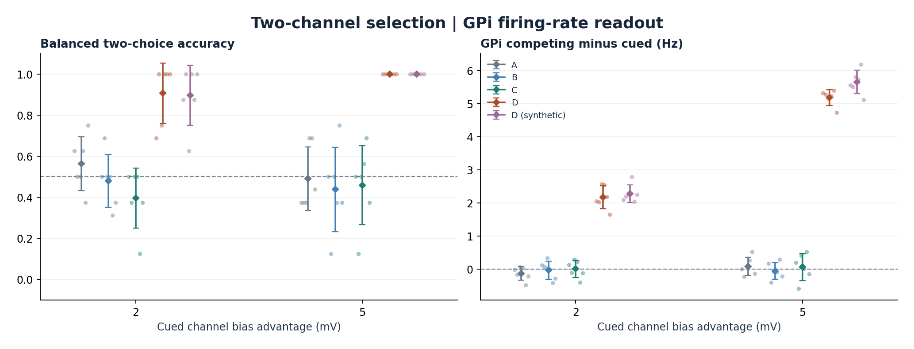
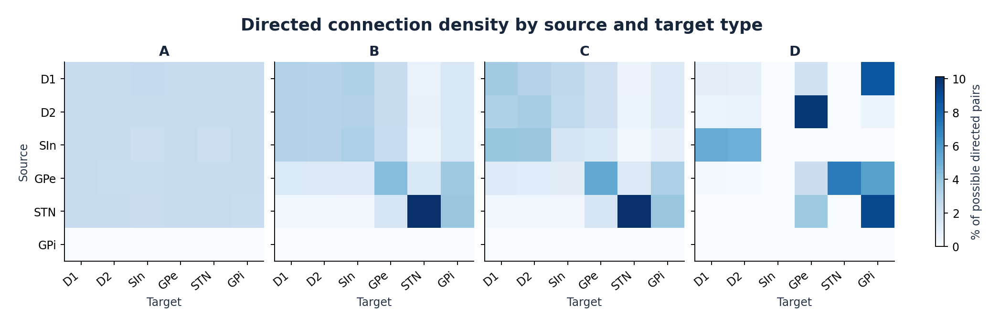
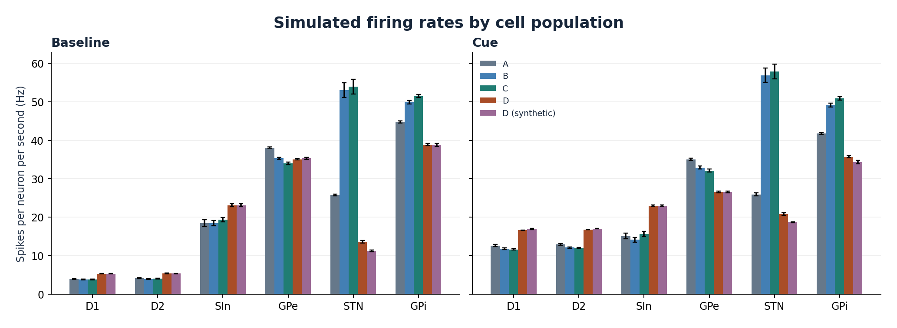
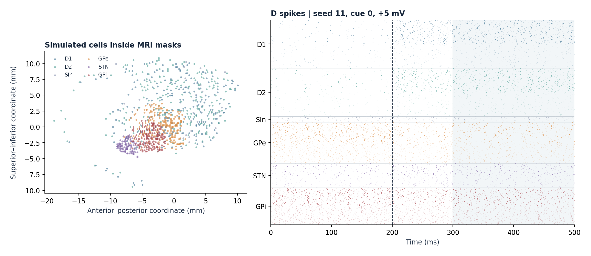

# 大脳基底核MVPの実行結果

公開MRIアトラスを使って1,000ニューロンを配置し、6シードで4条件と合成座標対照を実行した。各グラフは有向19,680接続（密度1.97%）、各シード・条件につき20試行、計30グラフ・600試行。全条件で発信ごとの接続数と興奮性・抑制性の本数を一致させた。下記はシード平均で、±はシード間の標準偏差。

## 配線と二択課題

| 条件 | 平均接続距離 | 平均遅延 | 2 mV差の選択スコア | 5 mV差の選択スコア |
|---|---:|---:|---:|---:|
| A ランダム | 9.34 mm | 11.87 ms | 56.3 ± 13.1% | 49.0 ± 15.5% |
| B 距離 | 5.60 mm | 7.72 ms | 47.9 ± 12.9% | 43.8 ± 20.5% |
| C 距離＋細胞種 | 5.48 mm | 7.58 ms | 39.6 ± 14.6% | 45.8 ± 19.2% |
| D 既知投射＋MRIアトラス | 6.80 mm | 9.06 ms | **90.6 ± 14.7%** | **100 ± 0%** |
| Dの合成座標対照 | 4.79 mm | 6.82 ms | **89.6 ± 14.6%** | **100 ± 0%** |

各入力差では条件ごとに48試行。整数で勝敗が決まらない同点は0.5点。破線は均等二択の50%と、入力の強い側・弱い側でGPi発火率差が0 Hzの位置。点はシード、ひし形とバーは平均±標準偏差。

- **距離制約で短い接続が増えた。** A→Bで平均距離は9.34→5.60 mm、双方向に存在する辺の割合は1.98→5.42%。C→Dでは許容する標的が変わり、平均距離は5.48→6.80 mm、入次数の細胞間標準偏差は5.81→17.49。Dの許容経路に該当する辺はA 79.9%、B 85.7%、C 86.9%、D 100%。Dの100%は生成ルールの整合性を示す。
- **この二択課題ではDの配線ルールで選択が安定した。** Cとの対応比較では、Dの平均選択スコアは2 mV・5 mVの両方で6シードすべて上回った。Dで入力の強い側のGPiは比較側より2.17 Hz（2 mV差）、5.18 Hz（5 mV差）低かった。Dは経路マスク、経路別の重み、同チャネル選好を同時に導入しており、この比較で各ルールの寄与を個別には推定できない。
- **MRI座標の利点は選択スコアで確認できなかった。** 合成座標でDとほぼ同じ成績が出た。2 mV差でMRI−合成の平均スコア差は+1.0ポイントで、シード別には−18.75〜+12.5ポイント。5 mV差では両方とも48/48試行を正しく選択した。一方、MRIマスクでのDではこの合成対照より平均距離が約2.01 mm長く、平均遅延も約2.24 ms長かった。差の大きさは比較に用いた合成配置に依存する。
- **等入力では選択の偏りが見られた。** 正解ラベルのない24試行で、チャネル0の選択割合はDで70.8%、D合成座標で41.7%。偏りと飽和のため、選択スコアは入力差や判定法を変えると変動しうる。

## 発火率

試行とチャネルをまとめた、1ニューロン当たりの発火率（Hz）。モデルの値をアカゲザルの生体内発火率に合わせる校正は実施していない。

| Dの細胞群 | ベースライン | 刺激期 |
|---|---:|---:|
| D1投射ニューロン | 5.32 | 16.63 |
| D2投射ニューロン | 5.40 | 16.77 |
| 線条体抑制性介在ニューロン | 23.11 | 23.00 |
| GPe | 35.02 | 26.58 |
| STN | 13.59 | 20.83 |
| GPi | 38.84 | 35.69 |

B・CのSTNはベースラインで53.0・53.9 Hz、Dは13.6 Hzだった。B・Cでは距離が近いSTN細胞間に興奮性の再帰接続があり、Dの経路マスクではこの接続がゼロになる。差の要因を個別に切り分けた実験は行っていない。全群の比較と代表ラスタは以下。

## 検証と限界

- NIfTIとHOMBAラベルから4領域を抽出し、両側の全ボクセル数が公式容積表に一致することを確認。採用側のボクセル数は背側線条体372,123、GPe 42,309、STN 3,700、GPi 20,363。
- 7件のテストが通過。シード11のアトラス版を別ディレクトリで再実行し、5条件の生データを比較。MRI入力を使わない合成モードもシード11でA〜Dの80試行を実行した。詳しい実行確認は `results/verification.txt`。
- アトラスは集団平均MRIに基づく領域境界を与える。1,000細胞の実位置、シナプス対、結合強度・伝導遅延、細胞型の比率、課題チャネルの位置は測っていない。線条体の空間RNAおよびPatch-seq電気生理は今回のパラメータ推定に使っていない。
- 単一半球の粗い集団モデルで、SNr、SNc、明示的な視床・皮質、ドーパミン、可塑性を省略した。GPi出力は発火の読み出しで近似している。課題自体が同チャネル配線を利用しやすい設計であり、6シードは独立した動物や提供者に相当しない。成績から言えるのは今回の課題とモデル設定で生じた違いまで。

[配線統計図](results/wiring.png) · [生データと実行記録](results/) · [設定と再現手順](README.md) · [原著・データ利用条件](SOURCES.md)
