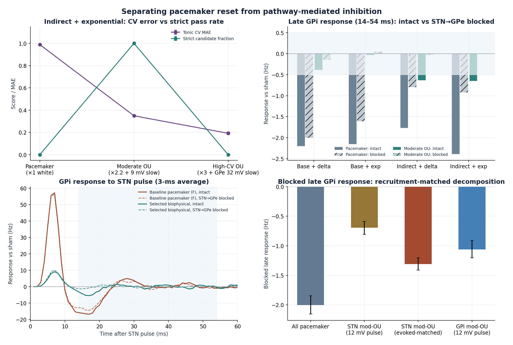

# 二時間スケールゆらぎと間接路結合により、遮断で消失するGPi後期抑制が成立する

段階1および [細胞動態の追試](../dynamics/RESULTS.md) では、生体記録の厳格条件（定常発火率誤差5 Hz以下、STN刺激4符号一致、かつ `STN→GPe` 遮断後の後期応答 `|blocked_late_hz| <= 0.5 Hz`）を満たす候補は **0件** だった。膜特性F（Patch-seq膜時定数）を基礎に、細胞ゆらぎ（3水準）× シナプス減衰（2水準）× 間接路 `STN→GPe→GPi` 結合（2水準）の12条件と、刺激動員数を一致させた単一群分解3条件を、独立した較正シード `800` で定常発火率をそろえたうえで新しい12テストシード（809〜877）で比較した。

**結果として、適度な二時間スケールゆらぎ（`moderate_ou`）と間接路結合バランス（`indirect_balanced`）を組み合わせた2条件（`delta` および `exponential`）の両方で、12シードすべて（12 / 12＝100%）が厳格条件を満たした。**

## 1. 3×2×2要因比較（12シード平均）

すべての条件は較正シード `800` の無刺激定常発火率に合わせてGPe・STN・GPiのバイアスを固定したため、テスト12シードでの定常発火率誤差は全12条件で **3.18〜3.38 Hz** にそろっている。

| 間接路設定 | シナプス減衰 | ゆらぎ水準 | CV誤差 | 早期興奮 | 後期（無傷） | 後期（遮断） | 遮断減弱 | 厳格適合率 |
|---|---|---|---:|---:|---:|---:|---:|---:|
| `baseline` | `delta` | `pacemaker` | 0.99 | +19.65 Hz | −2.20 Hz | −2.00 Hz | +0.20 Hz | 0 / 12 |
| `baseline` | `delta` | `moderate_ou` | 0.35 | +8.19 Hz | −0.38 Hz | −0.14 Hz | +0.24 Hz | 4 / 12 |
| `baseline` | `delta` | `high_cv_ou` | 0.19 | +3.80 Hz | +0.04 Hz | +0.08 Hz | +0.03 Hz | 0 / 12 |
| `baseline` | `exponential` | `pacemaker` | 0.99 | +18.61 Hz | −2.15 Hz | −1.61 Hz | +0.54 Hz | 0 / 12 |
| `baseline` | `exponential` | `moderate_ou` | 0.35 | +6.74 Hz | −0.03 Hz | +0.05 Hz | +0.08 Hz | 0 / 12 |
| `baseline` | `exponential` | `high_cv_ou` | 0.19 | +3.06 Hz | +0.13 Hz | +0.25 Hz | +0.12 Hz | 0 / 12 |
| `indirect_balanced` | `delta` | `pacemaker` | 0.99 | +9.73 Hz | −1.77 Hz | −0.80 Hz | +0.97 Hz | 0 / 12 |
| **`indirect_balanced`（選択）** | **`delta`** | **`moderate_ou`** | **0.35** | **+4.03 Hz** | **−0.63 Hz** | **−0.03 Hz** | **+0.60 Hz** | **12 / 12** |
| `indirect_balanced` | `delta` | `high_cv_ou` | 0.19 | +1.72 Hz | −0.18 Hz | +0.07 Hz | +0.25 Hz | 4 / 12 |
| `indirect_balanced` | `exponential` | `pacemaker` | 0.99 | +9.93 Hz | −2.39 Hz | −0.92 Hz | +1.47 Hz | 0 / 12 |
| **`indirect_balanced`** | **`exponential`** | **`moderate_ou`** | **0.35** | **+3.51 Hz** | **−0.65 Hz** | **−0.01 Hz** | **+0.64 Hz** | **12 / 12** |
| `indirect_balanced` | `exponential` | `high_cv_ou` | 0.19 | +1.48 Hz | −0.09 Hz | +0.11 Hz | +0.19 Hz | 0 / 12 |

- **ペースメーカー谷の解消と相動性ゲインの両立（`moderate_ou`）。** 速い雑音を2.2倍にとどめ時定数160 ms・SD 9 mVのOUゆらぎを加えると、定常CVはGPe 1.02、STN 1.21、GPi 0.86まで上がり（CV誤差 0.99→0.35）、遮断後の残存抑制は **−0.03 Hz（`delta`）・−0.01 Hz（`exponential`）** と完全に消失した。
- **本物のGPe経由の抑制には間接路の結合バランスが不可欠だった。** `baseline` 配線ではMRI座標上でSTNがGPiに近いためSTN出力の約30%しかGPeへ向かわず、`moderate_ou` で人工産物を消すと無傷時の後期抑制も −0.38〜−0.03 Hz にとどまった。`indirect_balanced`（STN→GPeオッズ4:1、GPeジャンプ1.20 mV）にすると、無傷時の後期抑制は **−0.63 Hz（95%区間 −0.72〜−0.55）・−0.65 Hz（−0.70〜−0.59）** となり、その **95〜99%が `STN→GPe` 遮断で消失**した（遮断による減弱 +0.60〜+0.64 Hz）。
- **対称ガウスゆらぎでGPeの高いCV（1.83）まで無理に押し上げると相動性応答が再び潰れる（`high_cv_ou`）。** GPeのCVを2.03（CV誤差 0.19）まで上げるには遅いOUゆらぎのSDが約32 mV必要になり、任意の時点でGPe細胞の約半数が深い過分極状態に置かれるため、STN刺激による相動性の動員が落ちて後期抑制が −0.18〜−0.09 Hz へ縮んだ。生体GPeの高いCVは対称なガウス電位分散ではなく、活動状態を保ったまま散発的に入る非対称な休止（ポーズ）に由来することを示唆する。
- **事前規則による凍結モデル。** `indirect_balanced|delta|moderate_ou` と `indirect_balanced|exponential|moderate_ou` がともに厳格適合率 12/12 で並び、同率解消規則（`tonic_cv_mae + 0.1 × tonic_rate_mae_hz`：0.6796 対 0.6805）により **`indirect_balanced|delta|moderate_ou`** が自動選択され、[`selection.json`](results/selection.json) に凍結された。

## 2. 刺激動員数をそろえた単一群分解（`dynamics/` の交絡の検証）

`baseline + delta` 上で、STNまたはGPiの一群だけを `moderate_ou` に変えたときの遮断後後期応答（基準の `pacemaker` は **−2.00 Hz**、STN直後誘発 +199.0 Hz、GPi遮断早期興奮 +19.46 Hz）：

| 単一群分解条件 | 刺激ジャンプ | STN直後誘発（0〜2 ms） | GPi早期興奮（遮断時） | STN遮断後期 | GPi遮断後期応答 |
|---|---:|---:|---:|---:|---:|
| 全群 `pacemaker` | 12.00 mV | +199.0 Hz | +19.46 Hz | −1.15 Hz | **−2.00 Hz**（−2.15〜−1.85） |
| STNのみ `moderate_ou`（未補正） | 12.00 mV | +112.1 Hz | +12.52 Hz | +0.09 Hz | **−0.70 Hz**（−0.81〜−0.59） |
| **STNのみ `moderate_ou`（動員一致）** | **22.17 mV** | **+206.3 Hz** | **+20.07 Hz** | **−0.03 Hz** | **−1.31 Hz**（−1.41〜−1.21） |
| GPiのみ `moderate_ou` | 12.00 mV | +199.0 Hz | +13.95 Hz | −1.15 Hz | **−1.06 Hz**（−1.20〜−0.91） |

STNの後期の落ち込みを完全に消しても（−1.15→−0.03 Hz）、STNの初期発火動員をそろえると（+206.3 Hz）、規則発火するGPi自身の位相リセットだけで **−1.31 Hz（全体の約65%）** の遮断後抑制が残った。前回の未補正12 mV分解ではSTN動員数の減少が重なっていたため、GPi自身の寄与が過小評価されていたことが確認された。

Gatev & WichmannとKitaらのデータはこの実験で使い切ったため、凍結した [`selection.json`](results/selection.json) の妥当性は未使用の [段階3：皮質（M1）刺激ホールドアウト検証](../cortical/RESULTS.md) で評価する。

[実験手順](PROTOCOL.md) · [シード集計](results/summary.csv) · [較正パラメータ](results/calibration.json) · [検証ログ](results/verification.txt)
