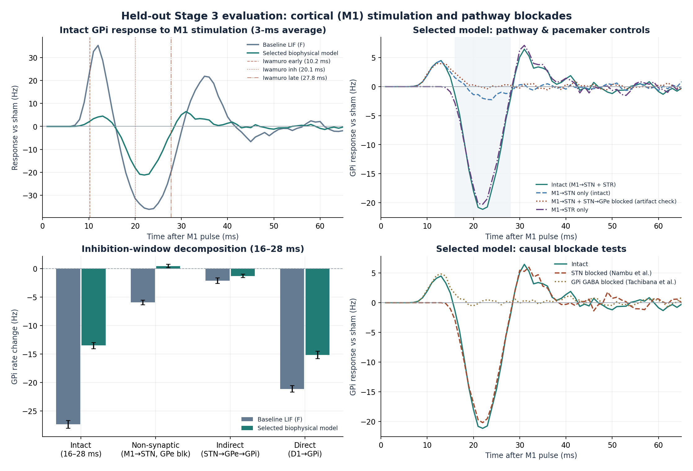

# 段階3　皮質（M1）刺激と経路遮断による盲検ホールドアウト検証

Gatev & WichmannおよびKitaらのデータで事前選択・凍結した機構改良モデル（[`biophysics/results/selection.json`](../biophysics/results/selection.json)：`indirect_balanced | delta | moderate_ou`）と、既定の単一区画LIF（膜特性F）を、パラメータを一切再調整せずに新しい12シード（907〜983）のM1単発刺激・経路遮断ベンチマークに1回だけ適用した。

**機構改良モデルは、非シナプス性の細胞動態アーチファクトを完全に除去（−5.95 Hz → +0.42 Hz）したうえで、Iwamuroらの三相開始潜時を平均誤差1.83 msで再現し、既定LIFが全滅（0 / 12）したTachibanaらのGPi局所GABA遮断テストを 10 / 12（83%）で通過した。一方でNambuらのSTN遮断では後期興奮が残り、受動LIFのSTNには脱抑制後のリバウンドバーストが欠けていることが盲検評価から特定された。**

## 1. 無傷回路の三相性応答と開始潜時（Iwamuroらとの比較）

12シード平均とブートストラップ95%区間。参照値は覚醒マカク前肢M1刺激に対するGPiの三相開始潜時（Iwamuroら 表1 `MIf`：10.2±3.0、20.1±4.2、27.8±4.4 ms）。

| 指標 | 既定LIF（F） | 凍結した機構改良モデル | 生体参照（Iwamuroら） |
|---|---:|---:|---:|
| 早期興奮（6〜16 ms平均） | +16.27 Hz | +2.07 Hz（+1.93〜+2.21） | 正 |
| 抑制相（16〜28 ms平均） | −27.31 Hz | −13.49 Hz（−14.10〜−12.98） | 負 |
| 後期興奮（28〜50 ms平均） | +3.74 Hz | +1.59 Hz（+1.18〜+1.98） | 正 |
| 三相符号の一致率 | 12 / 12 | **12 / 12** | — |
| 早期興奮の開始潜時 | 8.00 ms | **9.83 ms**（9.58〜10.00） | 10.2 ± 3.0 ms |
| 抑制相の開始潜時 | 16.42 ms | **16.42 ms**（16.17〜16.67） | 20.1 ± 4.2 ms |
| 後期興奮の開始潜時 | 30.92 ms | **29.25 ms**（28.75〜29.75） | 27.8 ± 4.4 ms |
| 3相潜時の平均絶対誤差 | 3.00 ms | **1.83 ms**（1.61〜2.06） | — |

すべての相の開始潜時が生体参照の平均±1 SD以内に収まり、3相潜時の平均誤差は3.00 msから1.83 msへ縮小した。

## 2. 事前登録した対照分解と薬理遮断テスト

| 介入・対照指標 | 既定LIF（F） | 凍結した機構改良モデル | 対応差（改良 − 既定） |
|---|---:|---:|---:|
| 非シナプス性寄与（`M1→STN`＋`STN→GPe`遮断、16〜28 ms） | **−5.95 Hz** | **+0.42 Hz**（+0.16〜+0.72） | +6.38 Hz（+5.80〜+6.98） |
| 間接路フィードフォワード寄与（`M1→STN` 無傷 − GPe遮断） | −2.16 Hz | **−1.33 Hz**（−1.61〜−1.02） | +0.83 Hz |
| 直接路寄与（`intact` − `D1→GPi`遮断、16〜28 ms） | −21.11 Hz | **−15.17 Hz**（−15.84〜−14.50） | +5.94 Hz |
| `M1→STRd` のみで早期興奮が出ない割合 | 12 / 12 | **12 / 12** | 0 |
| **GPi局所GABA遮断後の抑制窓応答（Tachibanaら）** | **−5.89 Hz（0 / 12 合格）** | **+0.08 Hz（10 / 12 合格）** | +5.97 Hz（+5.35〜+6.58） |
| STN遮断による早期興奮の減弱（Nambuら） | +16.36 Hz | **+2.11 Hz**（+1.98〜+2.24） | −14.25 Hz |
| **STN遮断による後期興奮の減弱（Nambuら）** | +1.93 Hz（12 / 12 合格） | **+0.06 Hz（5 / 12 合格）** | −1.87 Hz（−2.34〜−1.37） |
| 全因果チェック同時合格率 | 0 / 12（0%） | **4 / 12（33%）** | +33%（+8%〜+58%） |

## 3. 盲検評価から得られた知見と次の課題

1. **Tachibanaら（2008）のGPi局所GABA遮断の再現（0/12 → 10/12）。** 既定LIFではGPiへのGABA入力をすべて遮断しても、直接興奮 `M1→STN→GPi` 直後のペースメーカー谷によって −5.89 Hz の偽の「抑制」が残り全シードで不合格となった。二時間スケールゆらぎを導入した機構改良モデルでは、GABA遮断により抑制相（+0.08 Hz）とそれに続く後期興奮の両方が消失し、Tachibanaらの記録と一致した。
2. **`M1→STN` 対照における間接路抑制と細胞動態の分離。** 改良モデルの `M1→STN` 単独刺激（無傷）では16〜28 msに −0.90 Hz（`STN→GPe` 遮断との差 −1.33 Hz）の抑制が現れたが、`STN→GPe` を遮断すると +0.42 Hz となり、この抑制が細胞動態アーチファクトではなく `M1→STN→GPe→GPi` シナプス経路に由来することが確認された。
3. **Nambuら（2000）のSTN遮断で明らかになった受動LIFモデルの限界。** 改良モデルでSTN出力を全遮断すると早期興奮は完全に消えた（+2.07 → −0.04 Hz）が、28〜40 msの後期興奮はほとんど減らなかった（減弱 +0.06 Hz；`M1→STRd` 単独刺激でも同等の後期興奮が出現）。これは改良モデルで `GPe→GPi` 抑制を強めた結果、`M1→D2→GPe` によるGPe発火低下が **STNを介さない直接の脱抑制（`GPe→GPi` 抑制の一時解除）** としてGPi後期興奮を生んでいるためである。生体でSTN遮断により後期興奮の大半が消える現象を再現するには、GPe抑制からの解放時にSTNがリバウンドバーストを起こす低閾値 $\text{Ca}^{2+}$ 電流（$I_T$）などの能動膜機構が必要になる。

[設定と事前登録手順](PROTOCOL.md) · [シード集計](results/summary.csv) · [モデル間対応差](results/paired_differences.csv) · [検証ログ](results/verification.txt)
