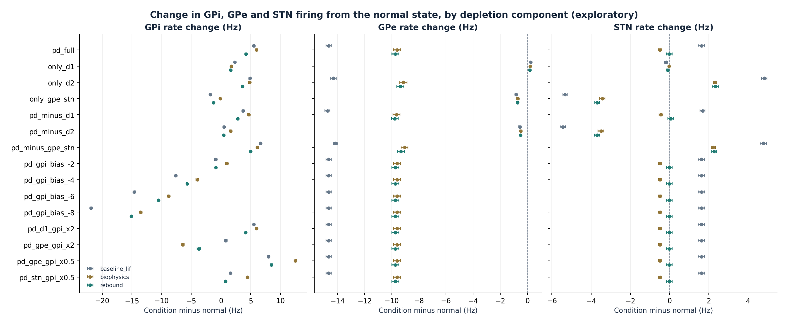

# ドーパミン枯渇の設定の分解：GPiの上昇はD2の過剰な脱抑制から生じ、GPi自身の興奮性の低下を加えると逆転する

凍結した3モデルで、段階4Bのドーパミン枯渇の設定を要素に分け、GPiの発火率を下げる変化も加えた16条件を、新しい12シード（2473〜2591）で比べた。手順とコードは実行前にコミットした（`28ef850`）。外部データは新たに使っておらず、**結果はすべてモデルについての仮説**である。

## 1. GPiの上昇の出どころ

正常状態からの変化（Hz、12シード平均。区間はすべて±0.3 Hz以内）。

| 条件 | 既定LIF | 段階2 | 段階4A |
|---|---:|---:|---:|
| 枯渇の設定すべて | +5.5 | +6.0 | +4.2 |
| D2の静止電位 +5.5 mV だけ | +4.9 | +4.8 | +3.6 |
| D1の静止電位 −4 mV だけ | +2.3 | +1.7 | +1.6 |
| GPe→STN 1.5倍だけ | −1.8 | −0.2 | −1.3 |
| すべてからD2を抜く | +0.5 | +1.6 | +0.5 |
| すべてからD1を抜く | +3.7 | +4.7 | +2.8 |
| すべてからGPe→STNを抜く | +6.7 | +6.1 | +5.0 |

- **上昇の大部分はD2の要素から来る。** D2を抜くと、上昇は0.5〜1.6 Hzまで縮む。
- **D2の設定は線条体の活動を大きく変えすぎている可能性がある。** 段階4Aで、D2 SPNは4.0 → 31.7 Hz（約8倍）、D1 SPNは3.9 → 0.07 Hz（ほぼ無発火）になった。GPeはD2からの抑制で34.0 → 24.3 Hzに下がり、GPiへの抑制が減ってGPiが上がる。古典的な間接路の図式そのものの経路。
- **D1→GPiを2倍にしても効果はない。** PD状態ではD1がほぼ発火しないため。
- **GPe→STNの増強はGPiをわずかに下げる**（STNが3〜5 Hz下がるため）。

## 2. GPiを下げる変化

| 条件（枯渇の設定すべてに追加） | 既定LIF | 段階2 | 段階4A |
|---|---:|---:|---:|
| GPiの静止電位 −2 mV | −0.9 | +1.0 | −0.9 |
| GPiの静止電位 −4 mV | **−7.6** | **−4.0** | **−5.7** |
| GPiの静止電位 −6 mV | −14.6 | −8.8 | −10.5 |
| GPiの静止電位 −8 mV | −21.9 | −13.5 | −15.1 |
| GPe→GPi 2倍 | +0.8 | **−6.4** | **−3.7** |
| GPe→GPi 0.5倍 | +8.0 | +12.5 | +8.5 |
| STN→GPi 0.5倍 | +1.6 | +4.4 | +0.8 |
| D1→GPi 2倍 | +5.5 | +6.0 | +4.2 |

- **GPi自身の興奮性の低下（静止電位 −4 mV以上）で、3モデルともGPiは下がる。** このとき、GPeとSTNの発火率はまったく変わらず（GPiは出力専用のため）、GPiの発火間隔のCVと振動指数は上がる（−8 mVでCV +0.17〜+0.26、指数 +0.09〜+0.23）。
- **GPe→GPiの増強でも下がる**（段階2・4Aで −3.7〜−6.4 Hz）。ただし既定LIFでは効かない。
- **STN→GPiを弱めても下がらない。** 段階4Aでは、STN→GPiの寄与がGPeの低下で打ち消されている。

DANDI:000947の低下（−26〜−43 Hz）は、ここで試した範囲（最大 −8 mVで −13〜−22 Hz）より大きい。合わせるには、より大きな興奮性の低下か、複数の変化の組み合わせが要る。ただし、使用済みのデータに合わせた値は検証には数えない。

## 3. 仮説として残すもの

| 仮説 | モデルでの表現 | 区別できる予測 |
|---|---|---|
| H1：ドーパミン枯渇でGPi自身の興奮性が下がる（原著が引く齧歯類SNrの報告と同じ方向） | GPiの静止電位の低下 | GPiの発火率が下がり、GPeとSTNは変わらない。GPiへの入力を薬理的に遮断しても、GPiの発火率は低いまま |
| H2：GPe→GPiの抑制が強まる | GPe→GPiの重みの増加 | GPiが下がる。GPiへのGABA入力を遮断すると、GPiの発火率は大きく戻る |
| H3：D2の設定が強すぎる | D2の静止電位の変化を小さくする | GPeの低下とGPiの上昇が小さくなる。単独ではGPiの低下までは生まない（D2を抜いても +0.5〜+1.6 Hz） |

H1とH2はどちらもGPiの低下と規則性の低下（CVの増加）を生むので、GPiの発火率とCVだけでは区別できない。区別するには、GPi内での局所的な薬理遮断の記録や、GPiの膜の性質の測定など、GPiの発火率以外のデータが必要になる。いずれの仮説も、検証には新しい未使用のデータが要る（[使用台帳](../DATA_LEDGER.md)、[データの収集](../heldout/COLLECTION.md)）。

## 限界

- 静止電位の低下は、膜の興奮性の変化を最も単純に近似したもの。原著が引く齧歯類の報告は、SNrの膜の興奮性とシナプスの性質の変化で、霊長類のGPiでの測定ではない。
- D1の設定（静止電位 −4 mV）でD1 SPNがほぼ発火しなくなる点も、生体の記録と比べて極端な可能性がある。
- 課題に集中した状態は、このモデルには表せない。

[手順](PROTOCOL.md) · [全条件の集計](results/summary.csv) · [シードごとの値](results/conditions.csv)
