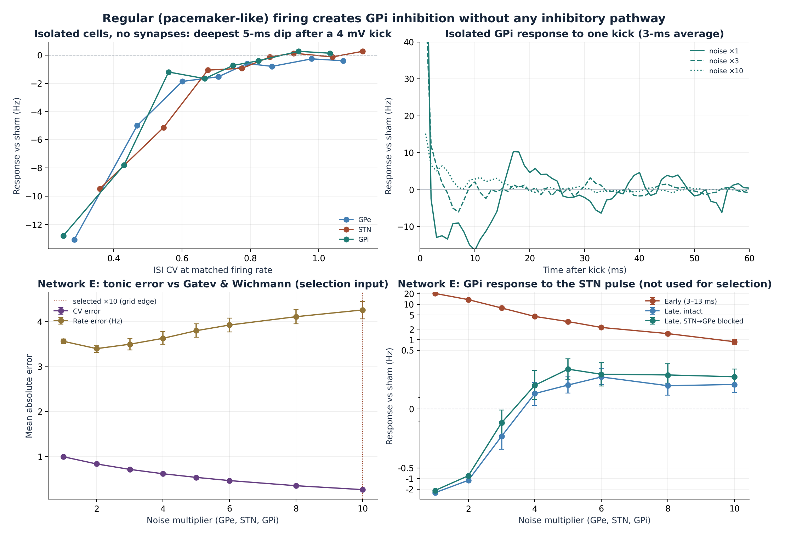

# 遮断後に残るGPi抑制は、配線ではなく細胞の発火の規則性から生じていた

段階1で、STN→GPeを遮断しても後期のGPi抑制が残り、生体の遮断結果を満たす配線は0件だった。配線を固定し、GPe・STN・GPiの発火の規則性だけを変えて原因を調べた。**既定の設定では、刺激後の後期抑制の約87%が、抑制性の経路を介さずに生じていた。** 発火を不規則にするとこの成分は消えた。しかし、GPeを介した本来の抑制は、どの設定でも0.5 Hz未満にとどまった。

## 孤立細胞で起きること

シナプスのない細胞に4 mVの電位ジャンプを1回与え、同じ雑音の無刺激対照と比べた。各倍率でバイアスを解き直し、発火率は既定値（GPe 42.6、STN 30.3、GPi 49.1 Hz）に固定した。

| GPi | 雑音×1（既定） | ×3 | ×5 | ×10 |
|---|---:|---:|---:|---:|
| 発火間隔CV | 0.25 | 0.56 | 0.75 | 1.03 |
| 平衡電位−閾値 | +7.0 mV | +4.7 mV | +0.7 mV | −12.5 mV |
| 直後0〜2 msの応答 | +89.9 Hz | +52.0 Hz | +32.9 Hz | +15.2 Hz |
| 3〜27 msで最も深い5 ms区間 | **−12.8 Hz** | −1.2 Hz | −0.7 Hz | +0.1 Hz |

既定の設定では平衡電位が閾値より高く、細胞はほぼ一定の間隔で発火する。興奮で発火が前倒しになると、その後の発火が一斉に遅れて谷ができる。GPe（−13.1 Hz）とSTN（−9.5 Hz）でも同じだった。CVが約0.7を超えると谷はほぼ消えた。

## ネットワークでの比較

既知投射と経路別オッズの配線（前回のE）を新しい12シードで固定し、GPe・STN・GPiに同じ倍率を入れた。値は膜特性Eのシード平均と、シード再抽出による95%区間。

| 雑音の倍率 | 発火率誤差 | CV誤差 | 早期興奮 | 後期（遮断なし） | 後期（遮断あり） | 遮断による減弱 | 4符号一致 |
|---|---:|---:|---:|---:|---:|---:|---:|
| 1（既定） | 3.56 Hz | 0.99 | 20.44 Hz | −2.53 Hz | −2.19 Hz | +0.34（0.14〜0.54） | 3.58 |
| 2 | 3.39 Hz | 0.83 | 13.64 Hz | −1.13 Hz | −0.84 Hz | +0.29 | 3.58 |
| 3 | 3.49 Hz | 0.71 | 7.91 Hz | −0.23 Hz | −0.12 Hz | +0.11 | 3.17 |
| 5 | 3.79 Hz | 0.53 | 3.26 Hz | +0.20 Hz | +0.34 Hz | +0.14 | 2.25 |
| 10（選択） | 4.25 Hz | 0.26 | 0.88 Hz | +0.21 Hz | +0.27 Hz | +0.07 | 2.00 |

- **既定の設定の後期抑制は、ほとんどが遮断後も残る成分だった。** −2.53 Hzのうち−2.19 Hzが残った。遮断後、刺激がGPiに届く経路はSTN→GPiの興奮だけになる。それでも抑制が出ることは、配線によらない成分があることを示す。
- **原因はSTNとGPiの両方の規則的な発火。** 倍率5を一群だけに入れた分解では、遮断後の後期応答は次のようになった（既定は−2.19 Hz）。
  - STNだけを変える：−0.07 Hz（−0.21〜+0.07）
  - GPiだけを変える：−0.48 Hz（−0.59〜−0.38）
  - GPeだけを変える：−2.20 Hz（−2.41〜−2.01）
  
  STNは刺激で一斉に発火した後に発火が減り、GPiへの定常的な興奮が下がる（STNの遮断後の後期応答は既定で−1.11 Hz）。GPiはそれに加えて自身の谷を持つ。
- **GPeを介した抑制は、どの設定でも小さかった。** 遮断による減弱（遮断ありとなしの後期応答の差）のシード平均は、全倍率・膜特性E・Fで+0.02〜+0.54 Hz。原著では遮断で抑制が消える。モデルに足りないのは細胞動態ではなく、STN→GPe→GPiの抑制の強さかタイミングと考えられる。この点は今回検証していない。
- **事前に決めた規則が選んだのは倍率10で、探索範囲の端だった。** CV誤差は0.99から0.26に減り、発火率誤差は3.56から4.25 Hzに増えた。早期興奮は0.88 Hzまで縮んだ。刺激への応答が雑音に埋もれる方向で、GPeのCVは1.11と参照値1.83に届かない。

## 選んだ設定での段階1の再評価

倍率10で、段階1と同じ192グラフ×膜特性E・Fを再評価した。

| | 既定の設定（段階1） | 倍率10 |
|---|---:|---:|
| 定常発火率の誤差5 Hz以下かつ4符号一致 | 225 / 384 | **0 / 384** |
| それに遮断後の抑制消失も満たす | 0 / 384 | 0 / 384 |
| 投射仮説の判別：連続値、ノイズなし（E / F） | 100% / 100% | 91.1% / 92.7% |
| 同：個体間SDの1倍＋窓のノイズSD 2 Hz（E） | 88.6% | 48.2% |
| 同じ仮説内の近いペア（E、480対中の基準仮説） | 49 | 472 |

倍率10では、後期抑制の符号が合わず、粗い条件を満たす候補もなくなった。STN刺激への応答が小さくなったため、基準仮説とGPi寄りの仮説の64対はすべて連続値で区別できなくなった。投射仮説を区別できるかどうかは、細胞動態の設定に強く依存する。辺の重なりについての結論（近いペアとランダムなペアで差がない、E: p=0.73、F: p=0.59）は変わらなかった。 [再評価の集計](results/ensemble/ensembles.csv) · [ノイズ下の判別](results/ensemble/noise_discrimination.csv)

## 結論と次の一歩

1. 段階1・検証で「後期抑制」の符号一致として数えた部分は、大部分がLIFの規則的な発火から生じていた。刺激応答の符号一致は、配線の妥当性の根拠として弱い。
2. 不規則な発火にすると人工産物は消えるが、GPeを介した抑制も早期興奮も小さくなり、Kitaらの応答の形は再現できない。単一区画のLIFの雑音とバイアスだけでは、定常のばらつきと刺激応答を同時には合わせられない。
3. 次に試す候補は、STN→GPe→GPiの抑制の強さ・遅延の仮説比較と、休止やバーストを持つ細胞モデルの導入。どちらも、Gatev & WichmannのCVとKitaらの結果を設定に使った以上、評価は皮質刺激の三相性応答など未使用のデータで行う。段階3の対照は [設定資料](../identifiability/CORTICAL_BENCHMARK.md) に追記した。

区間は12シードの再抽出によるもので、個体間の変動を含まない。分解の倍率5と、選択された倍率10は別の設定。

[設定と再現手順](PROTOCOL.md) · [シード集計](results/network_summary.csv) · [選択の記録](results/selection.json) · [検証ログ](results/verification.txt)
