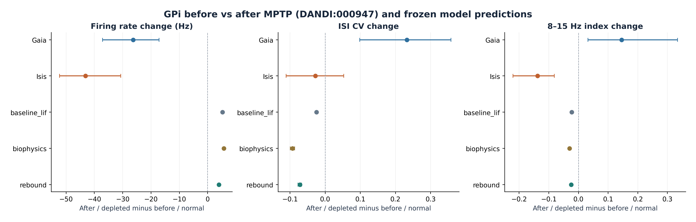

# DANDI:000947によるホールドアウト検証：3つの凍結モデルはGPiの発火率の向きを外した

段階4Bの凍結した3モデルの予測を、同じ2頭のアカゲザルのMPTP投与前後のGPi単一ユニット記録（DANDI:000947）と比べた。手順・解析コード・モデルの予測は、スパイク時刻を読む前にコミットした（`9457434`）。このデータは一度も設定・選択に使っておらず、今回の評価で使用済みになった。

**3モデルとも、PD状態でGPiの発火率が上がると予測したが、データでは2頭とも大きく下がった。** 採点（3点満点）は既定LIF 1点、段階2 0点、段階4A 0点で、既定LIFの1点もCVの「変化なし」の一致によるもの。

## 結果（主解析、手がかり刺激前1秒）

| 指標 | Gaia（投与前 → 後） | Isis（投与前 → 後） | データの判定 | 既定LIF | 段階2 | 段階4A |
|---|---|---|---|---|---|---|
| 発火率 | 70.7 → 44.4 Hz、−26.3（−37.2〜−17.2） | 56.3 → 13.2 Hz、−43.1（−52.3〜−30.7） | **低下** | 上昇 +5.2 | 上昇 +5.7 | 上昇 +4.0 |
| 発火間隔のCV | 0.92 → 1.15、+0.23（+0.10〜+0.36） | 0.89 → 0.86、−0.03（−0.11〜+0.05） | 変化なし | 変化なし ✓ | 低下 | 低下 |
| 8〜15 Hzの振動指数 | 0.67 → 0.81、+0.15（+0.03〜+0.33） | 0.60 → 0.46、−0.14（−0.22〜−0.08） | 2頭で逆向き | 変化なし | 変化なし | 変化なし |

値はユニットの中央値。括弧はセッション単位の再抽出による95%区間。対象は226ファイルのGPiユニット654個のうち基準を満たした646個（Gaia 投与前151・後129、Isis 投与前206・後160。CVと指数は基準を満たす数がやや少ない）。品質ラベルが excellent / good のユニットに絞った感度分析でも、すべての判定と採点が同じだった。全数値は [`data_effects.csv`](results/data_effects.csv)・[`scores.csv`](results/scores.csv)・[`verdict.json`](results/verdict.json)。

## 事後の確認（判定には使っていない）

- **原著と一致する。** Kaseら（2025）は、注意を保った安静時のGPiの平均発火率が投与前69.0 Hzから投与後26.5 Hzへ下がったと報告している。今回の抽出もこれと同じ向き・同程度の低下を示したので、抽出の誤りではないと判断した。原著の結果は採点の後に初めて確認した。
- **区間に特有ではない。** 各ユニットの記録全体での発火率（中央値）は、Gaia 71.4 → 48.2 Hz、Isis 57.9 → 15.8 Hz。運動開始後1秒でも Gaia 74.5 → 55.0 Hz、Isis 59.2 → 17.2 Hz（[`posthoc_units.csv`](results/posthoc_units.csv)、[`posthoc.py`](posthoc.py)）。
- **これまでの文献とも食い違う。** 検索で見つかったMPTPマカクの研究の多くは、GPiの発火率の上昇か小さな変化を報告している。この食い違いの原因（投与の方法、障害の進み具合、記録した部位の違い、ユニットの選ばれ方など）はここでは切り分けられない。

## 読み取り

1. **ドーパミン枯渇の設定が、このデータとは逆向きのGPiの変化を生んだ。** 3モデルに共通する操作（D1の興奮性の低下、D2の脱抑制、GPe→STNの増強）は、古典的な「間接路が強まりGPiの出力が増える」という図式に沿っており、このデータの大きな低下とは合わない。モデルの間の違い（細胞動態、ループの配線、リバウンド）は、この主要な食い違いに対してほとんど意味を持たなかった。
2. **データ自体の解釈にも幅がある。** 同じ方向を原著も報告している一方、多くの先行研究とは異なる。このデータが特定の準備（投与方法など）に特有なのか、一般的なのかは、この検証からは分からない。
3. **この結果でモデルや設定を直しても、検証にはならない。** このデータは使用済みになった。発火率が下がる方向へ設定を変えて合わせれば、合うのは当然で、評価には数えない（[使用台帳](../DATA_LEDGER.md)）。

## 実行中の変更

- 試行表（`intervals/trials`）を持たないファイルが1つあり、最初の実行がそこで止まった（結果の書き出しも採点も行われていない）。規則では区間は試行から作るため、試行表のないファイルのユニットは区間0個で解析に含まれない。この扱いをそのままコードに書き足して再実行した。判定の規則は変えていない。
- 実行前の説明で対象を「166ファイル」と書いたのは数え違いで、台帳どおり226ファイルだった。

## 出典

データ：Kase, D., Han, Y., Zimnik, A., Cox, K., Turner, R. (2024) Reach-related Single Unit Activity in the Parkinsonian Macaque (Version 0.240510.2211). DANDI archive. https://doi.org/10.48324/dandi.000947/0.240510.2211 （CC-BY-4.0）。`results/units.csv` と `results/posthoc_units.csv` は、このデータから計算したユニットごとの値。

原著：Kase et al. (2025) Movement-related activity in the internal globus pallidus of the parkinsonian macaque. *J Neurophysiol* 134:741–765. [doi:10.1152/jn.00611.2024](https://journals.physiology.org/doi/full/10.1152/jn.00611.2024) · [PubMed 39257740](https://pubmed.ncbi.nlm.nih.gov/39257740)

[手順](PROTOCOL.md) · [調査](SURVEY.md) · [モデルの予測](predictions/predictions.csv)
