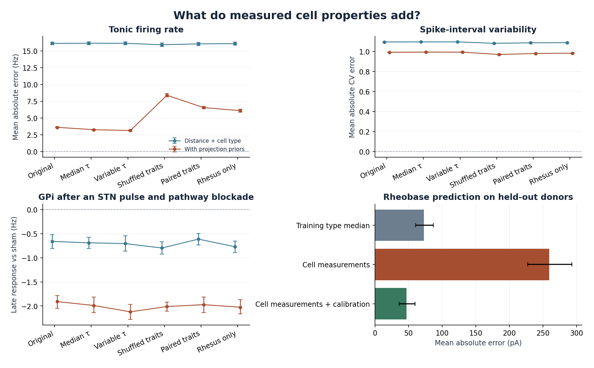

# 細胞ごとの膜特性で予測はどこまで改善するか

公開Patch-seqの背側線条体SPN 207細胞・46ドナーを用いた。膜時定数、静止電位から発火閾値までの電位差、入力抵抗を同じ細胞で対応付けた。D1は103細胞、D2は104細胞。うちアカゲザルは30細胞・6ドナー。ネットワークでは1,000ニューロン・19,680接続を固定し、2種類の配線×6種類の膜特性モデルを12シードで比較した。 [原著](https://doi.org/10.1016/j.cell.2026.10.028) · [採用細胞と統計](results/cell_cohort.csv)

## 単一細胞の予測

長い電流ステップで細胞を発火させる最小電流（rheobase）を、ドナーを一個体ずつ取り分けて予測した。全ドナーを等加重した平均絶対誤差は以下のとおり。

| 予測方法 | 誤差 |
|---|---:|
| 訓練ドナーの細胞型別中央値 | 72.9 pA |
| 各細胞の測定値を受動膜式に直接代入 | 259.3 pA |
| 各細胞の測定値を使い、訓練ドナーで倍率を較正 | **47.1 pA** |

較正付きの細胞別予測は、細胞型別中央値から誤差を **25.7 pA（35%）** 減らした。対応95%区間は −41.0〜−10.1 pA。D1とD2の両方で誤差が低下した。アカゲザル6ドナーに限る差は −19.9 pA、区間は −51.2〜+22.2 pAで、種を限定した効果の大きさは不確か。入力の活動電位閾値は短い電流ステップ、予測対象は長い電流ステップで測っている。較正には予測対象ドナーのrheobaseを使っていない。 [原著の測定方法](https://pmc.ncbi.nlm.nih.gov/articles/PMC13160158/) · [ドナー単位の集計](results/donor_summary.csv)

## 回路全体の予測

GPe・STN・GPiの定常発火率の平均絶対誤差。各列で座標と辺は同一。表は12シード平均。

| 追加した膜特性 | 距離＋細胞型の配線 | 既知投射を含む配線 |
|---|---:|---:|
| 元の固定値 | 16.11 Hz | 3.62 Hz |
| 群ごとのτ中央値 | 16.14 Hz | 3.27 Hz |
| 細胞ごとのτ | 16.13 Hz | **3.15 Hz** |
| 3特性を組み合わせ、値の対応をシャッフル | **15.91 Hz** | 8.39 Hz |
| 3特性を実際の組み合わせのまま使用 | 16.04 Hz | 6.56 Hz |
| 同じ手順でアカゲザルだけ使用 | 16.08 Hz | 6.11 Hz |

- **既知投射を使わない配線では、膜特性を増やした効果は小さかった。** 3特性を実測の組み合わせにすると、中央値条件から誤差が0.10 Hz減った（対応95%区間 −0.16〜−0.04 Hz）。視床下核は52.60 Hzで、覚醒アカゲザルの参照値17.07 Hzとの差が大きく残った。 [定常発火の外部参照](https://pmc.ncbi.nlm.nih.gov/articles/PMC2677649/#T1)
- **同一細胞内の特性の対応は、回路指標に影響した。** 既知投射を含む配線では、全く同じ値をシャッフルした場合から組み合わせを戻すと誤差が1.84 Hz減った（−2.03〜−1.67 Hz）。一方、τ中央値のみの条件との比較では3.29 Hz増えた（+3.12〜+3.43 Hz）。膜電位差と入力抵抗のばらつきは、切片の実測値を生体内モデルの閾値と入力倍率に対応付ける仮定の下で評価した。
- **低い発火間隔CVと、遮断後に残る抑制は解消しなかった。** 既知投射の6条件で発火間隔CVの平均誤差は約0.97〜0.99。遮断後の発火率差の後期平均はすべて約−1.9〜−2.1 Hzだった。 [刺激・遮断の外部参照](https://pmc.ncbi.nlm.nih.gov/articles/PMC6725523/)

細胞ごとの実測は、較正した切片モデルで細胞の発火しやすさを予測する情報になった。回路では、測定した特性がシナプス入力や実際の位置とどう組み合わされるかが未検証。ここでは既知投射なしのモデルで大きな外部誤差が残り、既知投射を使う場合も複数の特性を加えた効果は指標ごとに異なった。95%区間はシードまたはドナーの再抽出に基づく。回路の区間は個体間変動を含まない。

テスト14件が通過。公開データを再取得し、別実行でシード307の全12条件とドナー集計が一致した。既存の検証もシード101で再実行して一致した。 [設定・利用条件・再現手順](PROTOCOL.md) · [対応差一覧](results/network_paired.csv) · [検証ログ](results/verification.txt)
