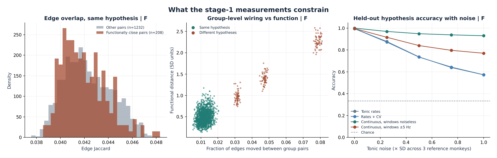
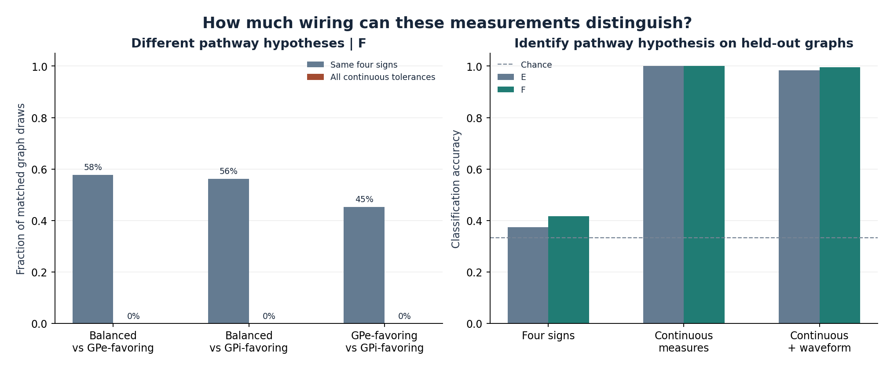

# 段階1　出力が近くても、配線はどれだけ違うか

4配置×16乱数×3投射仮説で192の有向グラフを生成し、膜特性E・Fを同じグラフに適用した。1,000細胞・19,680辺を固定。**今回の測定は個々の辺について情報を持たず、群対ごとの接続量については情報を持つ。** 投射仮説の判別精度は、生体の個体差程度の測定ノイズを入れると大きく下がった。

> **改訂（追加解析）。** 初版では「出力が近いペアでも辺の重なりは約8%」と書いた。この値は、同じ仮説から無作為に選んだペアの重なりと同じだった。また、刺激応答の符号一致のうち後期抑制は、大部分が配線によらない細胞動態から生じていた（[追試](../dynamics/RESULTS.md)）。以下はこの2点を反映した。

## 個々の辺は識別できない

基準の投射オッズを固定した64グラフで、定常発火率の平均絶対誤差はEで3.34〜3.91 Hz、Fで2.98〜3.53 Hz。同じ配置・別の乱数からなる480対のうち、発火率、CV、遮断前後の刺激応答のすべてが指定の許容差内だったのは **Eで49対、Fで58対**。少なくとも1つの近い別配線を持つのはEで44/64グラフ、Fで47/64グラフ。

近いペアの辺のJaccard類似度（共通辺数÷和集合）は、近くないペアと区別できなかった。同じ仮説内の全1,440対で、配置と仮説の層ごとに「近い」ラベルを並べ替えた2,000回の検定を行った。

| 膜特性 | 近いペア | その他 | 差 | 層内並べ替えの95%範囲 | 両側p |
|---|---:|---:|---:|---:|---:|
| E | 0.0418（205対） | 0.0424 | −0.0006 | −0.0006〜−0.0004 | 0.11 |
| F | 0.0420（208対） | 0.0423 | −0.0004 | −0.0005〜−0.0002 | 0.51 |

辺の距離（1−Jaccard）と機能の距離の順位相関は−0.09（E）、−0.10（F）。これは予想できる結果でもある。モデルでは同じ群の細胞が同じパラメータを持つため、群内で標的を入れ替えても集団の指標は変わらない。辺単位の同定は、この測定の組では構造上不可能で、問いの単位として適さない。

## 群対ごとの接続量は機能と対応する

各グラフを保存済みの乱数から再生成し（保存値のSTN→GPe割合と一致を確認）、6×6の群対ごとの辺数を数えた。2グラフの違いを「群対の間で移る辺の割合」で表すと、同じ仮説内では中央値1.2%（最大2.0%）、異なる仮説間では中央値4.7%（最大8.1%）。機能の距離（10指標を標準化した二乗平均平方根）との順位相関は、異なる仮説間で0.91（E）・0.91（F）、同じ仮説内でも0.29・0.22だった。群対の接続量の差は、同じ仮説内の小さな揺らぎでも出力に一部反映される。

## 別の投射仮説を区別できたか

STNの有向出力のうちGPeに流れる割合は、各仮説の平均で11.0%、32.5%、64.8%。両極の仮説でも、刺激の4つの符号判定はEで33/64対、Fで29/64対が一致した。連続値の10指標がすべて許容差内のペアは、異なる仮説間の各比較で0/64だった。

| 使う情報 | Eの判別精度 | Fの判別精度 |
|---|---:|---:|
| 刺激応答の4つの符号 | 37.5% | 41.7% |
| 定常活動と刺激時間窓の連続値 | 100% | 100% |
| 連続値と遮断前後の全波形 | 98.4% | 99.5% |

配置と配線乱数を分けてテストした最近傍重心法。均等3択の偶然水準は33.3%。今回は出力配分を大きく離した仮説で、より近い仮説や別の経路の差に対して同じ精度が出るかは未検証。

### 測定ノイズを入れた場合

上の100%は、同じ仮説内のばらつきが非常に小さいモデル同士の比較による。例えば、GPeの発火率のシード間SDは約0.2 Hz。そこで、取り分けた試験側の測定値にだけノイズを加え、同じ分割で判別した（各分割100回、特徴ごとに「モデルのばらつき²＋ノイズ²」の平方根で尺度化）。定常発火率とCVのノイズは、Gatev & Wichmannの3個体間のSDを基準にした（発火率 GPe 7.4、STN 2.8、GPi 4.6 Hz、CV 0.31、0.15、0.12）。3個体からのSDのため、この基準自体の不確かさは大きい。刺激応答の窓は個体差の参照値がないため、0〜10 HzのSDを仮定して振った。

| 使う情報（F） | ノイズなし | 個体間SDの0.5倍 | 個体間SDの1倍 |
|---|---:|---:|---:|
| 定常発火率のみ | 99.5% | 73.6% | 57.3% |
| 定常発火率＋CV | 99.5% | 73.4% | 57.3% |
| 連続値10指標、窓のノイズなし | 100% | 94.9% | 93.0% |
| 連続値10指標、窓のノイズSD 2 Hz | 99.8% | 91.7% | 88.5% |
| 連続値10指標、窓のノイズSD 10 Hz | 99.4% | 77.1% | 65.7% |

Eもほぼ同じ値。CVを加えても判別は改善しなかった。判別を支えているのは主にSTN刺激後の早期興奮の大きさ（Eで3仮説の平均11.5、20.1、24.4 Hz）。この特徴は細胞動態の設定に強く依存し、不規則発火の設定では約1〜3 Hzまで縮む（[追試](../dynamics/RESULTS.md)）。全数値は [`noise_discrimination.csv`](results/noise_discrimination.csv)。

## 生体記録に対する適合性

384評価のうち、定常発火率の平均絶対誤差5 Hz以下かつ刺激の4項目の符号が全一致したのは225件。さらに遮断後の後期応答の絶対値が0.5 Hz以下という抑制消失の近似を加えると **0件**。候補数はサンプリングしたモデル内の数で、実際の脳の配線の総数や真の投射配分を推定した値ではない。生体ではGPe内の薬理的遮断を用いており、モデルのSTN→GPe無効化との違いも残る。 [定常発火率の原著](https://pmc.ncbi.nlm.nih.gov/articles/PMC2677649/#T1) · [遮断実験の原著](https://pmc.ncbi.nlm.nih.gov/articles/PMC6725523/)

遮断後の後期応答は、384評価すべてで負だった（最大−0.57 Hz）。3仮説をまたぐと、早期興奮の大きさとの相関はr＝−0.90（E）、−0.88（F）。STN→GPiの直接興奮が強い仮説ほど、遮断後の抑制も深い。[追試](../dynamics/RESULTS.md)で、この抑制はSTNとGPiの規則的な発火から生じ、抑制性の経路を必要としないことを確かめた。厳格条件の0件は、配線の候補が見つからなかったことより、このモデル族の細胞動態の限界を示す。

この結果から、問いの単位は個々の辺ではなく群対の接続量に置くのが妥当。後者は指定した大きな差なら区別できたが、精度は測定ノイズと細胞動態の設定に強く依存した。今後の刺激で問う差も、経路仮説の幅、遮断の影響、応答の大きさ・時間、想定する測定ノイズを個別に明示する。

[条件と再現手順](PROTOCOL.md) · [配線対の集計](results/pair_summary.csv) · [外部記録への適合](results/ensembles.csv) · [辺と群対の解析](structure.py) · [段階2の実データ予備解析](../spatial/RESULTS.md) · [検証ログ](results/verification.txt)
