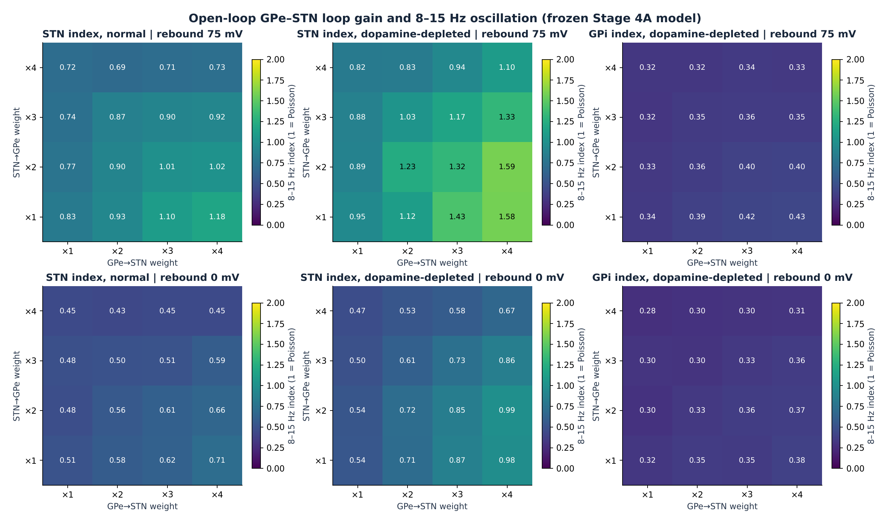

# 開ループのGPe–STN回路：STNにはリズムが出たが、GPiには伝わらなかった

段階4Aの凍結モデルで、GPe→STNとSTN→GPeの辺の重み（各1〜4倍）とSTNのリバウンド（75 mV、0 mV）を変えた32条件を、新しい12シード（2297〜2381）で比べた。各条件で正常状態の発火率を凍結モデルの目標に較正し直した（最大誤差0.84 Hz、較正の失敗なし）。手順と判定は結果より前にコミットした（`fe176da`）。外部データは新たに使っていない。

**事前に決めた判定では、PD特異的な振動を示す条件はなかった（32条件すべてで12シード中0シード）。** ただし内訳は、「閉ループがないから振動が出ない」という説明とは一致しない。

| 条件（リバウンド75 mV） | STN 正常 | STN PD | GPi PD | PDのSTNピーク |
|---|---:|---:|---:|---:|
| GPe→STN×1、STN→GPe×1（凍結モデル相当） | 0.83 | 0.95（0.88〜1.02） | 0.34 | 18.0 Hz |
| GPe→STN×3、STN→GPe×1 | 1.10 | 1.43（1.37〜1.50） | 0.42 | 19.5 Hz |
| GPe→STN×4、STN→GPe×1 | 1.18 | **1.58**（1.46〜1.71） | 0.43 | 14.5 Hz |
| GPe→STN×4、STN→GPe×2 | 1.02 | **1.59**（1.44〜1.74） | 0.40 | 17.3 Hz |

振動指数は8〜15 Hzの平均パワーを55〜150 Hzの平均パワーで割った値で、ポアソン過程では1。12シード平均、括弧は95%区間。

- **STNは、開ループのままでもPD状態でリズムを示した。** GPe→STNを強めるほど、PD状態のSTNの指数が上がった。GPe→STN×4では1.5を超え、正常状態の1.3〜1.6倍になった。STNだけで事前基準と同じ判定をすると（事後の集計）、GPe→STN×4・STN→GPe×2で8/12シード、×4・×1で6/12シードが合格した。
- **リバウンドが必要だった。** リバウンド0 mVでは、どの利得でもPD状態のSTNの指数は0.99以下だった。
- **GPiにはリズムが伝わらなかった。** GPiの指数は全条件で0.28〜0.43（シード単位の最大0.56）。正常状態でも0.3台で、ポアソン水準の1を大きく下回る。
- **STN→GPeを強めると、STNのリズムは弱まった。** GPe→STN×4では、STN→GPe×1・×2で1.58・1.59だったのが、×4で1.10になった。

## 読み取り

事前の解釈規則1に従い、この範囲の開ループ回路ではPD特異的な振動（STNとGPiの両方）は出なかった。ただし、STN単独では、GPe→STNの利得とリバウンドだけで基準を超えることがあった。段階4Bで挙げた「皮質―視床の帰還ループが必要」という説明は、少なくともSTNのリズムについては必要条件ではない可能性が高い。残った問題は、STNのリズムがGPiの集団活動に現れないことにある。

GPiの指数が正常状態から1を大きく下回る理由は、今回調べていない。規則的な発火や、GPiに集まる多数の入力が低周波の成分を打ち消すと、指数は下がりうる。もしそうなら、GPiで1.5という基準はこのモデルでは届きにくく、段階4Bのテスト2がそもそも満たしにくい設計だった可能性がある。この点は [陽性対照](../readout/RESULTS.md) で調べた。GPiの指数自体は機能するが、STNからGPiへの伝達でリズムが大きく弱まり、GPiが1.5に届くにはSTNの指数が約15必要だった。

いずれの結果も、Tachibanaら（2011）との一致には数えない（[使用台帳](../DATA_LEDGER.md)）。STN単独の集計とGPiの解釈は、結果を見た後の探索的な分析。

[手順](PROTOCOL.md) · [条件ごとの集計](results/summary.csv) · [全シードの値](results/evaluations.csv) · [較正の記録](results/variants.json)
