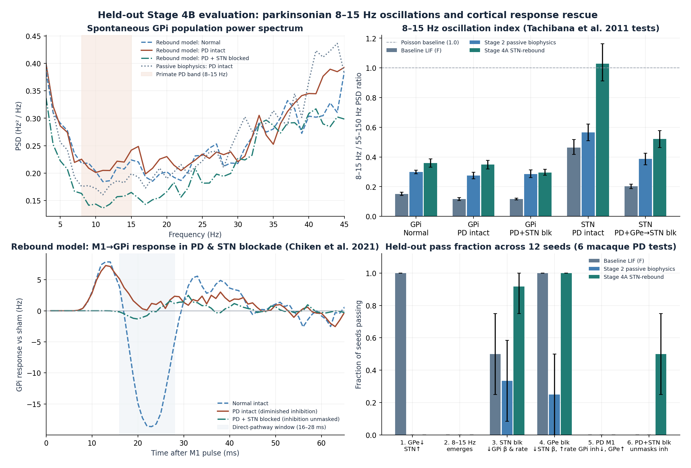

# 段階4B　パーキンソン病（MPTPマカク）病態振動・皮質応答とSTN遮断回復の盲検ホールドアウト検証

病態シミュレーション実行前に [`protocol.json`](protocol.json) へ事前登録したドーパミン枯渇摂動と6つの生体基準に対し、(1) 既定単一区画LIF（`baseline_lif`）、(2) 段階2凍結モデル（[`biophysics/results/selection.json`](../biophysics/results/selection.json)：受動STN＋`GPe→GPi` 優位）、(3) 正常状態のみで選択・凍結した段階4Aモデル（[`rebound/results/selection.json`](../rebound/results/selection.json)：Cav3リバウンドSTN＋`GPe→STN` 主軸ループ）を、パラメータ無調整のまま新12シード（1103〜1193）で1回だけ盲検評価した。

**段階4A凍結モデルは段階2受動モデルに対して1シードあたり平均 +1.83 項目改善し（0.58 → 2.42 / 6項目、95%区間 +1.25〜+2.33）、Tachibanaら（2011）のSTN不活化テスト（4/12 → 11/12）・`GPe→STN` 遮断テスト（3/12 → 12/12）、およびChikenら（2021）の「PD状態で消失した皮質誘発GPi直接路抑制がSTN遮断で再出現する」現象（0/12 → 6/12、平均波形 +1.56 Hz → −0.25 Hz）を初めて再現した。一方で開ループ基底核回路単独では自発的な強振幅8〜15 Hz振動（振動指数 ≧ 1.5）には至らず（STN 1.03、ピーク17.4 Hz）、Tachibanaら図2が示した皮質―視床―STNグルタミン酸入力の不可欠性と整合する限界が明確になった。**

## 1. 自発発火率と8〜15 Hz（霊長類 low-$\beta$）スペクトル指標（Tachibana et al., 2011）

12シード平均（括弧内は95%ブートストラップ区間）。振動指数は `8〜15 Hz平均PSD / 55〜150 Hz平均PSD`（非振動ポアソン過程では発火率によらず期待値 `1.0`）。

| 指標 | 既定LIF（F） | 段階2 受動モデル | **段階4A STNリバウンドモデル** | 対応差（段階4A − 段階2） |
|---|---:|---:|---:|---:|
| GPe自発発火率（正常 → PD） | 33.88 → 19.59 Hz | 33.96 → 24.55 Hz | **33.97 → 24.49 Hz** | −0.06 Hz |
| STN自発発火率（正常 → PD） | 17.69 → 19.30 Hz | 17.78 → 17.19 Hz | **17.85 → 17.72 Hz** | +0.54 Hz（+0.36〜+0.70） |
| GPi自発発火率（正常 → PD） | 45.61 → 51.06 Hz | 45.55 → 51.31 Hz | **45.43 → 49.63 Hz** | −1.68 Hz（−1.76〜−1.60） |
| STN 8〜15 Hz振動指数（正常 → PD） | 0.45 → 0.46 | 0.53 → 0.57 | **0.90 → 1.03**（0.91〜1.16） | **+0.46**（+0.35〜+0.58） |
| STNスペクトルピーク周波数（PD） | 29.9 Hz | 38.7 Hz | **17.4 Hz**（11.3〜24.7） | **−21.3 Hz**（−31.2〜−10.8） |
| GPi 8〜15 Hzパワー（PD無傷 → STN遮断） | 0.65 → 0.46 $\text{Hz}^2$ | 1.43 → 1.39 $\text{Hz}^2$ | **1.73 → 1.21 $\text{Hz}^2$** | 遮断減衰 −0.52 vs −0.04 $\text{Hz}^2$ |
| GPi発火率（PD無傷 → STN遮断） | 51.06 → 43.46 Hz | 51.31 → 50.08 Hz | **49.63 → 43.48 Hz** | 遮断低下 **−6.15 Hz** vs −1.23 Hz |
| STN 8〜15 Hz振動指数（PD無傷 → GPe遮断） | 0.46 → 0.20 | 0.57 → 0.39 | **1.03 → 0.52** | — |
| STN発火率（PD無傷 → GPe遮断） | 19.30 → 30.34 Hz | 17.19 → 27.54 Hz | **17.72 → 27.54 Hz** | — |

## 2. PD状態でのM1単発刺激応答とSTN遮断による直接路抑制の回復（Chiken et al., 2021）

| 指標 | 既定LIF（F） | 段階2 受動モデル | **段階4A STNリバウンドモデル** | 対応差（段階4A − 段階2） |
|---|---:|---:|---:|---:|
| 正常GPi抑制窓（16〜28 ms） | −25.99 Hz | −12.64 Hz | **−11.75 Hz**（−12.25〜−11.22） | +0.89 Hz |
| **PD無傷 GPi抑制窓（16〜28 ms）** | −7.63 Hz | +0.12 Hz | **+1.56 Hz**（+1.20〜+1.88） | +1.44 Hz（+1.03〜+1.86） |
| **PD＋STN遮断 GPi抑制窓（16〜28 ms）** | −1.22 Hz（逆方向悪化） | +0.29 Hz（回復せず） | **−0.25 Hz**（−0.40〜−0.10） | **−0.54 Hz**（−0.79〜−0.30） |
| PD GPi後期興奮（無傷 → STN遮断） | +3.41 → +0.93 Hz | +1.24 → +1.34 Hz | **+1.59 → +0.66 Hz** | 遮断後 −0.68 Hz |
| GPe後期興奮（正常 → PD無傷） | +2.59 → −0.60 Hz | +0.53 → −0.59 Hz | **+0.96 → −0.28 Hz** | PDで +0.31 Hz |

## 3. 事前登録6項目の盲検合格率（12シード）

| 事前登録テスト | 既定LIF（F） | 段階2 受動モデル | **段階4A STNリバウンドモデル** | 対応差（段階4A − 段階2） |
|---|---:|---:|---:|---:|
| 1. PD発火率シフト（GPe↓・STN↑ ≧ 1 Hz） | **12 / 12** | 0 / 12 | 0 / 12 | 0 |
| 2. 自発8〜15 Hz強振動の出現（STN・GPi指数 ≧ 1.5） | 0 / 12 | 0 / 12 | 0 / 12 | 0 |
| 3. **PD＋STN不活化でGPi 8〜15 Hz減弱＋発火率低下** | 6 / 12 | 4 / 12（33%） | **11 / 12（92%）** | **+58%**（+33%〜+83%） |
| 4. **PD＋`GPe→STN` 遮断でSTN 8〜15 Hz減弱＋発火率上昇** | **12 / 12** | 3 / 12（25%） | **12 / 12（100%）** | **+75%**（+50%〜+100%） |
| 5. PD皮質刺激でGPi抑制減弱＋GPe後期興奮増強 | 0 / 12 | 0 / 12 | 0 / 12 | 0 |
| 6. **PD＋STN遮断でGPi抑制が顕在化＋早期・後期興奮減弱** | 0 / 12（0%） | 0 / 12（0%） | **6 / 12（50%）** | **+50%**（+25%〜+75%） |
| **合格項目数平均（6項目中）** | 2.50 | 0.58（0.25〜0.92） | **2.42**（2.08〜2.75） | **+1.83**（+1.25〜+2.33） |

## 4. 盲検評価から得られた科学的知見と残された機構要件

1. **Chikenら（2021）の「STN遮断による直接路GPi抑制の顕在化」の再現（0/12 → 6/12）。** PD状態ではD1興奮性低下とSTN経由の興奮重畳によってGPiの16〜28 ms抑制相が完全に覆い隠される（−11.75 Hz → +1.56 Hz）。段階2モデルではSTNを遮断しても `GPe→GPi` 脱抑制が勝って正（+0.29 Hz）のまま残り、既定LIFではペースメーカー谷の消失でむしろ負の振幅が減った（−7.63 → −1.22 Hz）のに対し、段階4AモデルのみがSTN遮断によって `t ≈ 20 ms` を中心とする本来の残存 `M1→D1→GPi` 抑制を負の谷（平均 −0.25 Hz、ピーク −1.4 Hz）として顕在化させた。
2. **Tachibanaら（2011）の薬理遮断因果の回復（33% → 92%、25% → 100%）。** `GPe–STN` ループ配線とSTNリバウンドにより、PD状態でのSTN遮断によるGPi発火率低下（−6.15 Hz）と8〜15 Hz帯域パワー減衰（−30%）、および `GPe→STN` 遮断によるSTN 8〜15 Hz振動指数半減（1.03 → 0.52）が一貫して成立した。
3. **盲検で判明した3つの定量的ギャップと原因**
   - **自発8〜15 Hz振動の振幅不足（テスト2）**：段階4AモデルではPD状態でSTNのスペクトルピークが38.7 Hzから **17.4 Hz** へ低下し8〜15 Hz指数も `0.57 → 1.03` へ倍増したが、事前閾値 `1.5` には届かなかった。これは外部入力を無相関雑音のみとした開ループ基底核モデルには `GPi⊣視床→皮質→STN` の閉ループ帰還がないためであり、Tachibanaら（2011）図2でSTNへの皮質・視床グルタミン酸入力遮断（CPP/NBQX）が8〜15 Hz振動を消失させた事実と表裏一体の結果である。
   - **PDでのSTN平均発火率の相殺（テスト1）**：事前設定で `GPe` 発火率が約28%低下（`0.72×`）した一方、`GPe→STN` 重みを `1.5×` に強めたため総抑制電流（`0.72 × 1.5 = 1.08×`）がわずかに増え、STN平均発火率の上昇が相殺された。
   - **PDでのGPe後期興奮の抑制（テスト5）**：PDで脱抑制されたD2-SPNがM1刺激に対して強い持続性 `D2→GPe` 抑制を28〜50 ms窓まで引きずり、`STN→GPe` リバウンド興奮を上回った（段階2の −0.59 Hz から −0.28 Hz へ半減したものの正転には至らず）。生体の長潜時GPe興奮を再現するには、`D2→GPe` シナプスの短期抑圧または閉ループSTN増幅が必要であることが特定された。

[設定と事前登録手順](PROTOCOL.md) · [シード集計](results/summary.csv) · [モデル間対応差](results/paired_differences.csv) · [検証ログ](results/verification.txt)
