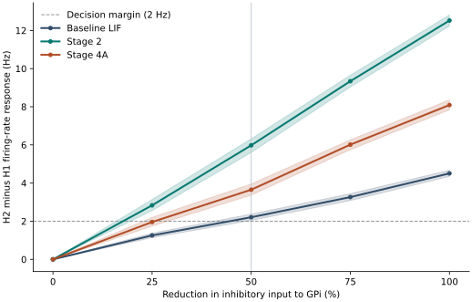

# GPiの発火率が同じでも、抑制入力を半分にすると2つの仮説の応答が分かれる

> **補足（事後の検討、2026年11月27日）。** 50%遮断での応答差は、H2の定義（GPe→GPiの重みが2倍）からほぼ直接に出てくる。同じ割合で弱めれば、取り除かれる抑制の絶対量はH2のほうが大きいからである。遮断率をずらすと差が逆転する感度分析は、この差が「取り除いた抑制の量」で決まることを示す。したがって、この応答差がH1とH2を見分ける手がかりになるのは、**実際の遮断率が既知で、条件間で等しい場合に限られる**。遮断率に左右されにくい比較として、抑制を完全に遮断したときの発火率を正常状態と比べた結果を、末尾の「事後の探索」に追記した。

同じ発火率を「GPi細胞自身の興奮性の低下」（H1）と「GPeからGPiに届く抑制の増強」（H2）で作った。GPiは淡蒼球内節、GPeは淡蒼球外節を指す。3モデルのすべてで、遮断前の両仮説の差は平均0.09 Hz未満だった。GPiへの抑制を両方で50%弱めるとH2の方が大きく発火率を回復し、その差は2.21〜5.98 Hzだった。H1でも発火率は上昇したため、単に発火が増えたという観察だけでは区別できない。

[実行前に固定した設定と判定基準（8a69b26）](https://github.com/SMB-Chan/bican-basal-ganglia-mvp/commit/8a69b26dce3451e72e34074dbe76c38d93f497e4) · [手順](PROTOCOL.md) · [全シードの発火率](results/rates.csv) · [対応差と区間](results/contrasts.csv)

## 同じ遮断率を与えたとき

1,000細胞・19,680有向辺のモデルを使った。H2はGPe→GPiの重みを2倍に固定。H1のバイアスを過去の12シードだけで補間し、今回の12シードには固定値として適用した。各シードで4条件（正常・既定の枯渇・H1・H2）×5遮断率×3モデルを比較。表は各回路のGPi全180細胞の発火率中央値について、12シードで平均した値（Hz）。応答は各仮説自身の遮断前からの増加を表す。

| モデル | H1バイアス変化 | 遮断前 H1 / H2 | 50%遮断時 H1の応答 | H2の応答 | 応答差 H2−H1（95%区間） |
|---|---:|---:|---:|---:|---:|
| 既定LIF | −1.47 mV | 46.29 / 46.33 | +3.03 | +5.24 | **+2.21**（2.04〜2.38） |
| 段階2 | −5.01 mV | 39.00 / 39.08 | +7.02 | +13.00 | **+5.98**（5.60〜6.32） |
| 段階4A | −3.18 mV | 42.01 / 42.00 | +4.76 | +8.41 | **+3.65**（3.37〜3.95） |

遮断前のH2−H1差の95%区間は順に −0.11〜+0.18、−0.19〜+0.35、−0.22〜+0.19 Hz。すべて事前の±1 Hzの範囲内に入った。50%遮断の応答差の区間下限は3モデルとも+2 Hzを超えた。既定LIFの下限は2.04 Hzで、閾値をわずかに上回った。シードを単位とした対応ブートストラップであり、この区間には生体個体差や実際の測定誤差は含まれない。



## 遮断がどれだけ効いたか分からないとき

事前に決めた感度分析で、H2を25%、H1を75%遮断すると、H2−H1の応答差は全モデルで負に転じた。逆の組み合わせでも併記する。

| 実効遮断率 H2 / H1 | 既定LIF | 段階2 | 段階4A |
|---|---:|---:|---:|
| 25% / 75% | −1.95 Hz | −4.33 Hz | −2.82 Hz |
| 75% / 25% | +6.47 Hz | +16.50 Hz | +10.79 Hz |

この結果が識別したのは、同じ強さで入力を減衰させたときの**モデル間の平均応答差**。単一の個体・細胞や、実効遮断率が未知の記録からH1/H2を分類できる精度は測っていない。発火率を合わせる目標値は以前のモデルのH2出力であり、以前に観測されたマカク2頭の大きな発火率低下に対する再較正は行っていない。既定LIFではH1・H2とも遮断前の発火率が正常（45.65 Hz）をわずかに上回った。

## 生体への対応

- GABA-B受容体拮抗薬を使ったGalvanらのマカク実験では、MPTP群のGPi 14細胞中9細胞で発火率が低下した。正常群では5細胞中4細胞が無応答。モデルで弱めたのは全抑制性シナプスの負の重みで、受容体の局在や抑制性終末での伝達物質放出の調節は含まない。この薬理記録を模擬遮断の直接の検証には使えない。 [Galvanら 2011、図4・結果](https://pmc.ncbi.nlm.nih.gov/articles/PMC3100374/)
- ラット黒質網様部のスライスでは、ドーパミン枯渇後にシナプス伝達遮断下の細胞の興奮性が低下し、淡蒼球刺激による抑制性応答も増大した。同じ研究で両方が観測されており、今回個別に比較した機構は生体内で共存しうる。対象の動物・出力核が異なるため、マカクGPiでの寄与の推定は未検証。 [Faynveitzら 2019、図3・4](https://doi.org/10.3389/fncel.2019.00417)
- 次に情報を増やす測定は、同じ標本で得たGPi細胞の電流–発火応答と、GPe由来の抑制性入力の大きさ・介入後の残存率。これらがあれば、固有興奮性、入力の強さ、操作の効き方を別々に制約できる。H3（D2の設定が強すぎる）は今回の比較対象に含めていない。

## 事後の探索：完全遮断したときの発火率を正常状態と比べる

以下は事前登録の結果を見た後に追加した探索で、判定には使わない。新しいシミュレーションは行わず、既存の [`rates.csv`](results/rates.csv) から計算した（[`full_block.py`](full_block.py)、[`full_block_posthoc.csv`](results/full_block_posthoc.csv)）。

GPiに入る抑制をすべて取り除くと、H2で強めた抑制は働く経路を失い、H2の回路は既定の枯渇条件と同じになる（実行時の検査で、全細胞のスパイク列が一致）。一方、H1のバイアス低下は残る。この比較は、各仮説にもともと抑制がどれだけあったかに左右されない。

| モデル | 遮断前 H1 / H2 − 正常 | 完全遮断 H1 − 正常（95%区間） | 完全遮断 H2 − 正常 | H1の差 ÷ 個体間SD |
|---|---:|---:|---:|---:|
| 既定LIF | +0.64 / +0.68 Hz | −3.89（−3.97〜−3.81） | +0.66 | −0.85 |
| 段階2 | −6.45 / −6.37 Hz | −12.71（−12.85〜−12.56） | −0.10 | −2.77 |
| 段階4A | −3.74 / −3.76 Hz | −8.28（−8.43〜−8.12） | −0.21 | −1.80 |

区間は12シードの対応付き再抽出（1万回）。個体間SDは、覚醒マカク3頭のGPiの発火率の標準偏差（4.59 Hz、Gatev & Wichmann、3頭からの粗い値）で、生体で検出できる大きさの目安として示した。

- **完全遮断では、H2はほぼ正常の水準に戻り、H1は正常より低いまま残った。** 遮断前は両仮説が同じ発火率でも、完全遮断で差が現れる。
- **生体で使うには条件がある。** 抑制の遮断が完全であること（GABA-AとGABA-Bの両方）、正常状態の基準（別の個体、または同じ個体の投与前）があること。既定LIFの差（−3.9 Hz）は個体間SDより小さく、個体間比較では検出しにくい。
- **モデルのシナプスは電流型で、抑制による膜のシャントを含まない。** 実際には、強い抑制は入力に対する発火の感度も下げうるため、遮断が不完全なときのH2の振る舞いや、電流–発火応答の傾きの違いは、このモデルでは判断できない。本文が挙げる「同じ標本での電流–発火応答と、GPe由来の抑制入力の残存率」の測定は、この点からも有用と考える。

## 再現と照合

```sh
python -m partial_block.run --out reproduced_partial_block --workers 3
python -m partial_block.verify reproduced_partial_block
python -m partial_block.plot reproduced_partial_block
python -m partial_block.full_block reproduced_partial_block   # 事後の探索
```

全720条件を作業数4と3で別々に実行し、発火率、対応差、判定ファイルがバイト単位で一致した。最初のシードの全60条件は、配線への操作を別に実装し、各ネットワークを単独で再計算しても一致した（許容差 10⁻¹² Hz）。発火の積分器と配線生成器は共通。既存のモデルテストは7件すべて通過した。

今回の計算環境はPython 3.12.14、NumPy 2.3.5、アトラスの読み込みにはNiBabel 5.3.2タグのソースを使用した。リポジトリ共通のrequirements.txtで指定されたNumPy 2.5.5での同一性は今回確認していない。[入力ハッシュ・判定結果](results/manifest.json) · [検証ログ](results/verification.txt)
