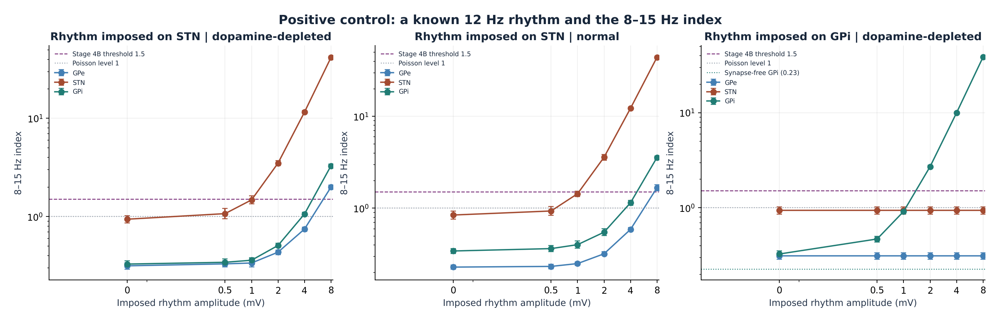

# 振動指数の陽性対照：GPiは基準に届くが、STNには約10倍強いリズムが必要

段階4Aの凍結モデルに既知の12 Hzのリズムを外から与え、段階4Bの振動指数（8〜15 Hzの平均パワー÷55〜150 Hzの平均パワー）がどう応答するかを、新しい12シード（2383〜2467）で調べた。手順と判定は結果より前にコミットした（`d9cfcb1`）。外部データは使っていない。

**事前に決めた2つの判定はどちらも合格した。** ただし、STNとGPiに同じ閾値1.5を課した段階4Bのテスト2は、両者に釣り合わない要求をしていた。

## 結果（12シード平均、括弧は95%区間）

| 条件（PD状態） | 振幅 | STNの指数 | GPiの指数 | GPeの指数 |
|---|---:|---:|---:|---:|
| リズムなし | 0 mV | 0.94 | 0.33（0.30〜0.35） | 0.31 |
| STNに与える | 1 mV | 1.47 | 0.36（0.34〜0.38） | 0.33 |
| 〃 | 2 mV | 3.49 | 0.51（0.48〜0.53） | 0.43 |
| 〃 | 4 mV | 11.54 | 1.06（1.01〜1.10） | 0.74 |
| 〃 | 8 mV | 41.54 | **3.27**（3.14〜3.41） | 1.99 |
| GPiに直接与える | 1 mV | 0.94 | 0.91（0.86〜0.97） | 0.31 |
| 〃 | 2 mV | 0.94 | **2.71**（2.61〜2.80） | 0.31 |
| シナプスを外した孤立GPi（正常状態の設定） | 0 mV | — | 0.23（0.21〜0.24） | — |

正常状態でもほぼ同じだった（[`summary.csv`](results/summary.csv)）。

| 判定 | 結果 |
|---|---|
| R1 STN経由でGPiが基準に届く | 合格。STNの指数が1.5以上になる振幅のうち、8 mV（STN 41.5）でGPiが3.27 |
| R2 GPiの指数が振動を捉えられる | 合格。GPiに直接与えると2 mVで2.71 |

## 読み取り

- **GPiの指数そのものは機能する。** GPiに直接リズムを与えると、STNに直接与えた場合と同程度に指数が上がった（2 mVでGPi 2.71、STN 3.49）。
- **STNからGPiへのリズムの伝達は大きく弱まる。** GPiの指数が1.5に届くのは、STNの指数が約15を超えてからだった（4〜8 mVの間を対数で補間した概算）。STNの指数が3.5でも、GPiは0.51にとどまった。
- **指数の基準水準が核ごとに違う。** リズムなしの指数はSTN 0.94、GPi 0.33、GPe 0.31で、シナプスを外したGPiでも0.23。「ポアソン過程なら1」という前提は、規則的に発火するこのモデルの細胞には当てはまらない。同じ閾値1.5は、STNには自分の水準の約1.6倍を、GPiには約4.5倍を求めることになる。

事前の解釈規則3に従えば、GPiの基準は到達可能で、段階4Bでの失敗は凍結したループ利得でSTNのリズムが出ないことによる。そのうえで、テスト2の「STNとGPiの両方で1.5」は、GPiについて実質的にSTNの約10倍強いリズムを求める設計だった。[開ループの探索](../oscillation/RESULTS.md)でSTNの指数が1.58〜1.59に達してもGPiが0.4前後だったことは、この伝達の弱まりで説明できる。

## 今後の指標への提案

段階4Bのテスト2を作り直す場合は、核ごとのリズムなしの水準（同じシードの正常状態や、リズムを壊したシャッフル）に対する比で判定するか、閾値を核ごとにこの陽性対照で較正するのが妥当と考える。ただし、段階4Bの記録（Tachibanaら 2011）はすでに使用済みなので、作り直した指標での評価はホールドアウトには数えない（[使用台帳](../DATA_LEDGER.md)）。

集計の書き出しで、孤立GPiの行だけ列が少ないため表の列がそろわない不具合があり、実行後に列をそろえる修正をした。判定の計算は変えていない。

[手順](PROTOCOL.md) · [判定の記録](results/verdict.json) · [全シードの値](results/evaluations.csv)
