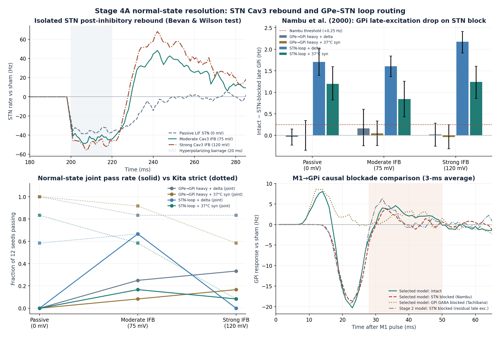

# 段階4A　STN脱抑制後リバウンド（Cav3）と淡蒼球―視床下核ルーティングの要因比較

段階3（[`cortical/RESULTS.md`](../cortical/RESULTS.md)）の盲検評価で残った「Nambuら（2000）のSTN遮断でGPi後期興奮が消えない」問題に対し、**正常状態の生理ベンチマークのみ**を用いて、(1) 淡蒼球―視床下核ルーティング（`gpe_gpi_heavy` vs `stn_loop_dominant`）、(2) シナプス減衰（`delta` vs 体温37°Cの `physiological_37c`）、(3) STN低閾値 $\text{Ca}^{2+}$ リバウンド（`passive` 0 mV / `moderate_ifb` 75 mV / `strong_ifb` 120 mV）の 2×2×3＝12条件を新しい12シード（1009〜1069；較正は独立シード800）で比較した。

**NambuらのSTN遮断不全は `GPe→GPi` 偏重配線から `GPe→STN` 主軸ループ配線へ戻すことで解消され（STN遮断による後期興奮減弱 −0.03 Hz → +1.60〜+2.17 Hz、合格率 2/12 → 12/12）、さらにSTNの過分極後リバウンドは過小（0 mV：孤立STNでリバウンド欠如）でも過大（120 mV：KitaらのGPe経由後期抑制を相殺して厳格合格 0/12）でも正常状態指標を落とすため、中間強度の `stn_loop_dominant | delta | moderate_ifb`（75 mV）が内部最適（M1全因果チェック 12/12、全正常指標同時合格 8/12）として自動選択・凍結された。**

> **改訂（[新しいシードでの確認](../confirmation/RESULTS.md)）。** 上の成績は、選択に使ったのと同じ12シードでの値。事前登録した新しい36シードでは、凍結した条件は再び選ばれ、同時合格は58%（95%区間 42〜75%）、次点との差は+0.31（+0.08〜+0.50）だった。一方、採点に使ったM1刺激と遮断のデータ（Iwamuroら、Nambuら、Tachibanaら 2008）は、段階3でホールドアウトとして評価した後にこの選択に使った。段階3の結果を見てから要因を設計したことも含め、このデータでの成績（M1全因果 12/12 など）は標本内の値で、以後のホールドアウトには数えない（[使用台帳](../DATA_LEDGER.md)）。`stn_loop_dominant` の投射オッズとジャンプの値は、実測値ではなく仮定。

## 1. 孤立STN細胞の過分極後リバウンド特性（Bevan & Wilson テスト）

200個の孤立STN細胞（`moderate_ou` ゆらぎ下）に20 ms（200〜220 ms）の過分極入力を与えた直後（222〜250 ms）のシャム差分応答（12シード平均と95%ブートストラップ区間）。

| STN膜動態 | リバウンドパラメータ | 解除直後 222〜250 ms（Hz） | リバウンド判定（≧ +5 Hz） |
|---|---:|---:|---:|
| `passive`（受動LIF） | 0 mV | **−16.71 Hz**（−17.54〜−15.80） | 0 / 12 |
| `moderate_ifb`（中程度Cav3） | 75 mV | **+18.20 Hz**（+17.31〜+19.09） | **12 / 12** |
| `strong_ifb`（強Cav3） | 120 mV | **+32.01 Hz**（+30.33〜+33.54） | **12 / 12** |

受動LIFでは過分極からの指数回復中も発火率がシャムを下回り続ける（−16.71 Hz）のに対し、IFBモデルでは `v < -68.5 mV` の過分極でのみ不活性化変数 $h$ が充電され、解放直後に一過性のリバウンドバーストを生じて自発的に終息する（定常発火時はリセット電位 `-68.0 mV >= -68.5 mV` のため $h$ は充電されない）。

## 2. 12要因条件の正常状態ベンチマーク比較（シード1009〜1069）

| 配線 × シナプス × STN動態 | 定常率MAE | Kita後期 / 遮断後（Hz） | Kita厳格 | M1三相潜時MAE | STN遮断の後期減弱（Nambu） | GABA遮断抑制窓（Tachibana） | M1全因果合格 | **全正常同時合格** |
|---|---:|---:|---:|---:|---:|---:|---:|---:|
| `gpe_gpi_heavy \| delta \| passive`（段階2相当） | 3.38 Hz | −0.58 / −0.08 | **12 / 12** | 1.68 ms | −0.03 Hz（2 / 12） | +0.44 Hz（12 / 12） | 2 / 12 | 0 / 12 |
| `gpe_gpi_heavy \| delta \| moderate_ifb` | 3.45 Hz | −0.69 / +0.04 | 10 / 12 | 1.65 ms | +0.16 Hz（4 / 12） | +0.68 Hz（12 / 12） | 4 / 12 | 3 / 12 |
| `gpe_gpi_heavy \| delta \| strong_ifb` | 3.50 Hz | −0.59 / +0.37 | 10 / 12 | 1.67 ms | +0.02 Hz（4 / 12） | +1.52 Hz（12 / 12） | 4 / 12 | 4 / 12 |
| `gpe_gpi_heavy \| physiological_37c \| passive` | 3.45 Hz | −0.59 / −0.03 | **12 / 12** | 2.90 ms | +0.00 Hz（4 / 12） | +1.01 Hz（12 / 12） | 3 / 12 | 0 / 12 |
| `gpe_gpi_heavy \| physiological_37c \| moderate_ifb` | 3.53 Hz | −0.60 / +0.18 | 11 / 12 | 3.10 ms | +0.05 Hz（3 / 12） | +1.19 Hz（12 / 12） | 1 / 12 | 1 / 12 |
| `gpe_gpi_heavy \| physiological_37c \| strong_ifb` | 3.62 Hz | −0.49 / +0.41 | 7 / 12 | 2.92 ms | −0.04 Hz（3 / 12） | +1.65 Hz（12 / 12） | 2 / 12 | 2 / 12 |
| `stn_loop_dominant \| delta \| passive` | 3.35 Hz | −0.62 / −0.29 | 7 / 12 | 2.22 ms | **+1.71 Hz（12 / 12）** | +0.76 Hz（10 / 12） | 10 / 12 | 0 / 12 |
| **`stn_loop_dominant \| delta \| moderate_ifb`（選択）** | **3.35 Hz** | **−0.41 / −0.09** | **8 / 12** | **1.92 ms** | **+1.60 Hz（12 / 12）** | **+1.87 Hz（12 / 12）** | **12 / 12** | **8 / 12（67%）** |
| `stn_loop_dominant \| delta \| strong_ifb` | 3.31 Hz | +0.08 / +0.57 | **0 / 12** | 1.58 ms | **+2.17 Hz（12 / 12）** | +2.93 Hz（12 / 12） | **12 / 12** | 0 / 12 |
| `stn_loop_dominant \| physiological_37c \| passive` | 3.26 Hz | −0.69 / −0.23 | 10 / 12 | 2.78 ms | +1.19 Hz（11 / 12） | +1.79 Hz（12 / 12） | 7 / 12 | 0 / 12 |
| `stn_loop_dominant \| physiological_37c \| moderate_ifb` | 3.32 Hz | −0.39 / +0.14 | 7 / 12 | 2.86 ms | +0.84 Hz（10 / 12） | +2.83 Hz（12 / 12） | 5 / 12 | 2 / 12 |
| `stn_loop_dominant \| physiological_37c \| strong_ifb` | 3.32 Hz | +0.17 / +0.94 | 1 / 12 | 2.72 ms | +1.24 Hz（11 / 12） | +3.40 Hz（12 / 12） | 6 / 12 | 1 / 12 |

## 3. 主要な機構的結論

1. **ルーティングの主効果（`GPe→GPi` 直接脱抑制 vs `GPe→STN→GPi` 間接路ループ）。** `gpe_gpi_heavy` ではSTNに強いCav3リバウンド（120 mV）を入れても、STN遮断時のGPi後期興奮減弱は `+0.02 Hz` にとどまった。これは `M1→D2→GPe` によるGPe休止がそのまま `GPe→GPi` の直接脱抑制としてGPi後期興奮を作るためである。霊長類解剖に沿って `GPe→STN` を主投射とした `stn_loop_dominant` では、STN遮断によりGPi後期興奮の約73%（`+2.19 Hz → +0.59 Hz`、差 `+1.60 Hz`）が消失し、12シード全件でNambuらの基準を満たした。
2. **探索範囲の端ではなく内部最適（`moderate_ifb` = 75 mV）が選ばれる理由。** 以前の [`dynamics/`](../dynamics/RESULTS.md) では定常CVのみを最小化したため探索上限（雑音×10）へ張り付いたが、今回は「過分極後リバウンド（下限を制約）」と「KitaらのSTN単発刺激における後期GPi抑制（上限を制約：`strong_ifb` 120 mVでは `STN→GPe⊣STN` フィードバック後の過剰なSTNリバウンドがGPiを再興奮させ、後期抑制が −0.41 Hz から +0.08 Hz へ潰れる）」の両側から挟まれるため、中間の `moderate_ifb`（75 mV）が明確な内部ピークとなった。
3. **37°C指数シナプスの影響。** `physiological_37c`（$\tau_{\text{inh}} = 4\text{ ms}$）はKita課題と遮断テストでは良好に機能したが、すでに膜時定数14 msを持つGPi上で `D1→GPi` の強大な直接路抑制（約 −10 Hz）の尾が28 ms以降へわずかに伸びるため、無傷M1刺激の後期興奮振幅が `+0.06〜+0.47 Hz` と小さくなり、三相開始潜時誤差も `1.92 ms → 2.86 ms` へ広がった。

事前規則により自動選択された [`results/selection.json`](results/selection.json)（`stn_loop_dominant | delta | moderate_ifb`）をそのまま凍結し、病態データを一切参照しないまま [段階4B パーキンソン病ホールドアウト検証](../parkinsonian/RESULTS.md) へ渡した。

[設定と事前登録手順](PROTOCOL.md) · [凍結モデル定義](results/selection.json) · [シード集計](results/summary.csv) · [検証ログ](results/verification.txt)
