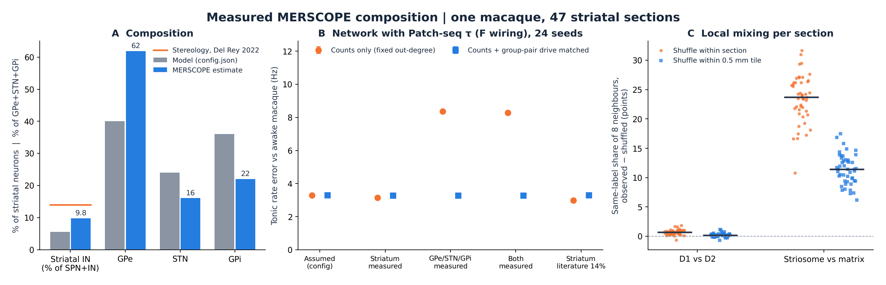

# 段階2　マカクMERSCOPEの実測組成と局所配置

ABC Atlasの `HMBA-BG-MERSCOPE-Macaque/20261101` の全行を取得し、元の座標、細胞型、領域注釈、標本情報を結合した。前回は4表の先頭8 MiBから1切片面だけを見た予備解析だった。今回は公式データのアカゲザル1個体 `QM23.50.001`（右半球、5スラブ、28切片面、85組織切片）の **3,255,402細胞** を照合し、QCと標本の切片面の一致を通過した **3,164,713細胞** を使った。 [公式データと利用条件（CC BY-NC 4.0）](https://alleninstitute.github.io/abc_atlas_access/descriptions/HMBA-Spatial-BG.html) · [Hewittらの原著](https://doi.org/10.1016/j.cell.2026.10.023) · [手順](PROTOCOL.md)

**この段階で分かったこと。** 背側線条体の介在ニューロン比率とGPe/STN/GPiの相対数は、モデルの設定値と異なった。D1とD2は数百µmより細かい範囲でほぼ無作為に混ざっていた。実測の群の大きさを代入したときの外部評価の変化は、細胞ごとの入力総量の変化で説明でき、入力総量を揃えると変化はほぼ消えた。

## 実測組成とモデルの設定値

| 量 | MERSCOPE | モデル（`config.json`） | 文献 |
|---|---:|---:|---:|
| 背側SPN中のD1の割合 | 49.6% | 50% | — |
| 線条体介在ニューロン（SPN＋介在ニューロンに対する割合） | 9.8% | 5.6% | — |
| 線条体介在ニューロン（全線条体ニューロンに対する割合） | 9.0% | — | 約14% |
| 　うちPTHLH-PVALB型 / PV陽性 | 3.3% | — | 2.6% |
| 　うちコリン作動性 / ChAT陽性 | 1.75% | — | 1.5% |
| GPe : STN : GPi のニューロン数比 | 62 : 16 : 22 | 40 : 24 : 36 | GPeが最多、GPiとSTNは同程度 |
| 背側線条体 / GPeのニューロン数比 | 約58 | 2.5 | — |

文献値は対照サルの立体解析（免疫組織化学）と、5種の基底核の立体解析。 [Del Reyら (2022)](https://doi.org/10.1111/nan.12812) · [Hardmanら (2002)](https://doi.org/10.1002/cne.10165)

- **線条体。** 背側と判定した格子に背側SPN 433,612個、介在ニューロン47,101個、eSPN 25,333個があった。500個以上の背側SPNをもつ51切片で、D1の割合の中央値は50.7%（四分位範囲48.0〜51.7%）。ストリオソーム型は背側SPNの28.2%。格子を0.5 mmにしても介在ニューロン比率は9.97%、D1は49.5%で、ほぼ変わらなかった。
- **文献との比較。** コリン作動性とPV系の比率は立体解析に近かった。介在ニューロン全体は約5ポイント低い。原著では介在ニューロンの約57%をカルレチニン陽性細胞が占める。転写産物による分類と免疫染色のマーカーは一対一に対応しないため、差がどの細胞型に由来するかはこのデータでは決められない。モデル用の比率からはeSPN（全線条体ニューロンの約5%）を除いた。
- **淡蒼球とSTN。** GPeは17切片で9,323個、STNは6切片で4,681個、GPiは10切片で2,206個のニューロンを含んだ。面積当たりの密度をMRIの片側体積に掛けて求めた比は、格子を0.05〜0.2 mmで変えても62:16:22前後（GPeの割合61.8〜62.6%）。GPeが最多という順序はHardmanらと一致した。この比は1個体の切片と25個体平均のMRI体積を組み合わせた推定で、切片の厚さや検出率が領域間で等しいことを仮定している。

モデルの線条体外の群は、実際の細胞数比よりもかなり多く取っている。1,000細胞の中で線条体:GPeを58:1にすると、GPeは約17細胞になる。今回は線条体500・線条体外500の合計を保ち、それぞれの内訳だけを実測に置き換えた。

## D1/D2の局所混在

信頼度の高い背側SPNを1,000個以上含む **47切片（23切片面、計400,125細胞）** で、最近傍8細胞のうち同じ型の割合を求めた。座標を固定してラベルだけを500回並べ替え、切片ごとに観測値との差を求めた。

| 比較 | 並べ替えとの差の中央値（四分位範囲） | 上側2.5%を超えた切片 |
|---|---:|---:|
| D1/D2、切片全体で並べ替え | +0.69ポイント（+0.43〜+0.91） | 30/47 |
| D1/D2、0.5 mm格子内で並べ替え | +0.18ポイント（−0.02〜+0.35） | 3/47 |
| ストリオソーム/マトリックス、切片全体（陽性対照） | +23.7ポイント（+21.5〜+26.2） | 47/47 |
| ストリオソーム/マトリックス、0.5 mm格子内（陽性対照） | +11.4ポイント（+9.4〜+13.0） | 47/47 |

D1/D2が同じ型どうしで近接する傾向は小さく、その大部分は0.5 mm以上の範囲の組成の偏りで説明された。同じ検定はストリオソーム区画の集積を全切片で検出しており、検出力の不足では説明しにくい。前回の1切面の結果（切片全体で+0.62、0.5 mm格子で+0.11ポイント）は全データでも同様だった。

モデルはD1とD2を同じMRIマスク内に一様に置いており、この粗い配置は今回の実測と矛盾しない。一方、ストリオソーム/マトリックスの区画構造はモデルに含まれていない。なお、配線の条件Cで使ったD1→D1の局所親和度（1.4倍）は配置ではなく接続の仮定で、この検定は接続の選好を測っていない。

## 実測組成を代入したネットワーク

1,000細胞の内訳を実測値に置き換え、既存の全段階と重複しない24シードで評価した。外部評価はvalidation段階と同じ覚醒アカゲザルの定常発火率（GPe・STN・GPiの平均絶対誤差）とSTN刺激。表はPatch-seq膜時定数を含む配線F。「組成のみ」は群の大きさだけを変え、「入力総量一致」は群対ごとに受け手1細胞当たりの平均入力を元の組成と揃える。

| 組成 | 組成のみ | 差（95%区間） | 入力総量一致 | 差（95%区間） |
|---|---:|---:|---:|---:|
| 元の設定 | 3.28 Hz | — | 3.28 Hz | — |
| 線条体を実測 | 3.14 Hz | −0.14（−0.17〜−0.10） | 3.28 Hz | −0.00（−0.01〜+0.01） |
| GPe/STN/GPiを実測 | 8.37 Hz | **+5.08（+4.97〜+5.19）** | 3.28 Hz | −0.00（−0.02〜+0.02） |
| 両方を実測 | 8.28 Hz | +5.00（+4.88〜+5.11） | 3.27 Hz | −0.01（−0.03〜+0.02） |
| 線条体を文献値14%に（感度分析） | 2.99 Hz | −0.29（−0.33〜−0.24） | 3.28 Hz | −0.00（−0.01〜+0.01） |

- **組成のみを変えると、GPe/STN/GPiの実測比で外部誤差が増えた。** 24シードすべてで増加した。GPe・STN・GPiの発火率は33.8→29.5、17.8→13.1、45.7→38.0 Hzに下がり、参照値（41.5、17.1、47.0 Hz）から離れた。出次数を固定しているため、GPeが増えSTNが減るとSTN 1細胞当たりの入力は10.9→17.7本、GPiでは37.7→42.6本に増える。総辺数も19,680→21,360本、STN由来の興奮性辺は2,880→1,920本に変わった。配線Eでも+4.96 Hz（+4.84〜+5.07）で同じ傾向。
- **入力総量を揃えると、組成の違いによる定常誤差の差は±0.02 Hz以内に収まった。** 群対ごとの重みの倍率は最大で約2倍（文献値の感度分析では約3倍）。発火間隔CVの誤差は組成のみの条件で0.05下がったが、すべての条件で約0.95〜0.99のまま残った。
- **刺激応答の変化の向きは刺激の定義に依存した。** STNの半数を刺激する元の定義では、4項目の一致数の差はどの代入でも区間が0をまたいだ。GPe/STN/GPiを含む組成のみの代入では、後期の発火率低下が0.25〜0.46 Hz小さくなった。一方、元と同じ60細胞（STN 80個の75%）を刺激すると、後期の低下は逆に0.5〜1.1 Hz大きくなり、入力総量一致のFでは一致数が+0.33（+0.08〜+0.58）増えた。刺激の強さを核の割合と細胞数のどちらで揃えるかで結論が変わるため、この差は組成の効果としては解釈しない。

このモデルと評価指標では、群の大きさは主に受け手1細胞当たりの入力総量を通じて結果に影響した。言い換えると、外部評価に対する元の設定の当てはまりは、仮定した群の大きさとシナプス重み・出次数の組み合わせに依存している。細胞数の実測だけでは1細胞当たりの入力数や重みが決まらないため、組成の実測値を単独で代入しても予測は改善しなかった。これは、組成とシナプス収束を対で測る必要があることを示す。今回の定常発火率と刺激応答は、入力総量を揃えた場合の組成の違いを区別する感度をもたなかった。

## 限界

- 1個体・右半球のみ。組織切片は互いに独立した動物ではなく、切片間のばらつきは個体差を含まない。
- 座標はスラブ面内の2次元。スラブ間とMRIテンプレートとの対応付けは引き続き確認できていない。前回確認した公開変換マニフェストの状況は変わっておらず、3次元の実位置をモデルに入れる比較は未実施。 [公開変換マニフェスト](https://allen-hmba-releases.s3.us-west-2.amazonaws.com/Hewitt_Turner_Cell2026/for_mike/QM23.50.001.CX44.transform_manifest.json)
- STNは6切片、GPiは10切片で、核全体を均等に覆ってはいない。体積はMRIアトラス由来で、同じ個体の測定ではない。
- 入力総量一致は群対の平均を揃える操作で、細胞ごとの入力数のばらつきは組成に応じて残る。生体の収束比を測った値ではない。
- 外部評価の細胞選択（高頻度発火のGPe細胞など）とモデルの群の対応は近似。

## 検証

テスト23件が通過。全データの集計を並べ替え回数20回と500回で2回実行し、入力ハッシュと並べ替え以外の全値が一致した。ネットワーク比較はシード653を別ディレクトリで再実行し、20行すべてが一致した。`validation/run_validation.py` に任意の辺重み引数を追加した後も、validation段階のシード101のE・Fの刺激応答が保存済みの値と一致した。 [検証ログ](results/verification.txt)

[全データの集計](results/census.json) · [切片ごとの近傍統計](results/spn_mixing_by_section.csv) · [組成比較の各評価](results/composition/composition_metrics.csv) · [対応差](results/composition/composition_paired.csv) · [皮質刺激の設定・評価資料](../identifiability/CORTICAL_BENCHMARK.md)
