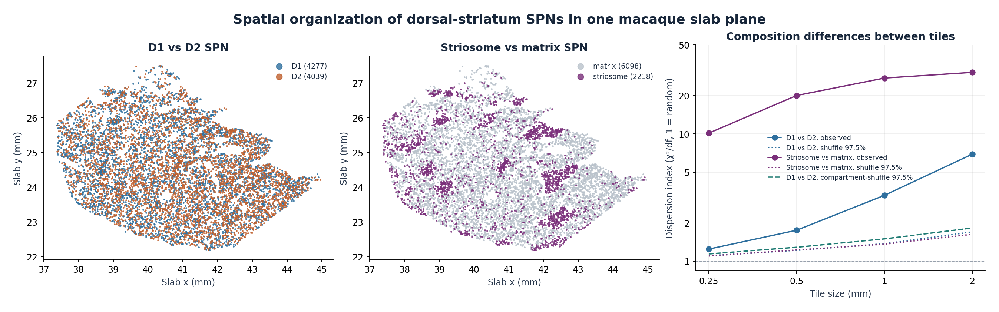

# 段階2　マカクMERSCOPEの実位置を確認する

ABC Atlasの `HMBA-BG-MERSCOPE-Macaque/20261101` を取得し、元の座標、細胞型、領域注釈、標本情報を結合した。対象は公式データのアカゲザル1個体 `QM23.50.001`。大きい4表はHTTP Rangeで先頭8 MiBずつ取得し、行の途中で終わる末尾を除いた。細胞IDで37,728行を照合し、QCと標本の切片面の一致を通過したのは36,857行。使用した入力のハッシュと実行条件は [`preflight.json`](preflight.json) に記録した。 [公式データと利用条件（CC BY-NC 4.0）](https://alleninstitute.github.io/abc_atlas_access/descriptions/HMBA-Spatial-BG.html) · [座標・解剖注釈の公式ノートブック](https://alleninstitute.github.io/abc_atlas_access/notebooks/hmba_bg_spatial_slabs_and_taxonomy.html) · [Hewittらの原著](https://doi.org/10.1016/j.cell.2026.10.023)

## 1切片の予備解析

切片面 `QM23.50.001.CX.44.Plane.05` で、背側線条体D1 SPN 4,277個、D2 SPN 4,039個の実測座標が得られた。領域注釈でSTR、細胞型階層が整合し、サブクラスとグループの両方のブートストラップ確率が0.8以上の細胞を選んだ。各細胞の近傍8個のうち同じD1/D2型の割合を比べた。位置と細胞数を共通に保ち、同じ切片内か、同じ切片かつ0.5 mm格子内で、細胞型ラベルだけを500回入れ替えた。

| 同じD1/D2型の近傍割合 | 割合 |
|---|---:|
| 観測された型と座標 | 50.64% |
| 切片内で型を無作為化 | 50.02% |
| 切片内の0.5 mm格子ごとに型を無作為化 | 50.53% |

同じ切片全体でラベルを入れ替えると観測値との差は0.62パーセントポイント。0.5 mm格子で各場所の型構成を保存すると差は0.11ポイントになり、観測値は並べ替えの中央95%範囲（50.06〜50.96%）に入った。これはデータファイルの一部から得た1切片の座標確認と探索的な比較。位置ごとの構成差と近接セルの細かな混在を扱うには、この二つの対照を区別する必要がある。個体差、全線条体、発火機能への効果は推定していない。

## 複数の空間スケールでの組成（追加解析）

上の近傍8細胞の比較は、細胞のすぐ隣の型を見る指標。より大きな規模の偏りを見るため、同じ8,316細胞で、切片を0.25〜2 mmの正方形に区切った。10細胞以上の区画ごとにD1の割合を求め、区画間のばらつきを散らばり指数（ピアソンχ²÷自由度）で表した。ラベルが場所と無関係なら約1になる。区画の格子位置を4通りずらして平均し、切片全体でラベルを入れ替えた500回の値と比べた。

解析法の検出力を確かめる陽性対照として、同じ細胞のうちストリオソームとマトリックスのラベルが付いた細胞（それぞれ2,218個、6,098個；計8,316細胞すべてに付与）を同じ手順で調べた。ストリオソームは斑状の区画を作ることが知られている。さらにストリオソームの方がマトリックスよりD1比率が高いため（55.9% vs 49.8%）、区画構造だけでD1/D2の散らばりが生じていないか確かめる対照として、ストリオソーム内・マトリックス内それぞれで独立にD1/D2ラベルを入れ替える層別シャッフル（500回）も追加した。

| 指標 | D1 vs D2 | D1 vs D2（区画内シャッフル97.5%点） | ストリオソーム vs マトリックス |
|---|---:|---:|---:|
| 近傍8細胞が同型の割合（観測） | 50.64% | — | 81.69% |
| 同（0.5 mm格子内で入れ替え、平均） | 50.53% | — | 70.56% |
| 散らばり指数 0.25 mm（全体入れ替え97.5%点） | 1.25（1.11） | 1.14（平均1.03） | 10.1（1.10） |
| 同 0.5 mm | 1.75（1.22） | 1.29（平均1.05） | 20.0（1.23） |
| 同 1 mm | 3.29（1.37） | 1.50（平均1.09） | 27.4（1.36） |
| 同 2 mm | 6.93（1.70） | 1.83（平均1.10） | 30.4（1.63） |

全スケールで、観測値は全体シャッフルおよび区画内層別シャッフルの500回のどれよりも大きかった（いずれも片側p = 0.002、入れ替え回数で決まる下限）。

- **解析法は既知の区画構造を検出した。** ストリオソームは近傍の水準でも区画の水準でも強くまとまっていた。
- **D1とD2のmm規模の勾配は、ストリオソームの偏在だけでは説明できない。** 区画ごとのD1比率差（55.9% vs 49.8%）を保った層別シャッフルでも2 mm区画の散らばり指数の帰無平均は1.10（97.5%点 1.83）にとどまり、観測値6.93の大部分は区画内部を横断するmm規模の組成勾配に由来する。
- **現行モデルへの含意（訂正）。** モデルの距離カーネルは `exp(-d/3 mm)` で、1 mm未満の配置差はほとんど配線に反映されない。一方、現行の `connect("D")` では線条体内の局所結合（`D1→D1/D2`）と淡蒼球への投射（`D1→GPi`, `D2→GPe`）が同じ固定出次数24枠を距離重み付きで競合しており、MRI上の `STRd` からGPi重心までの距離は5.17〜16.58 mmと大きく広がる。したがって明示的なトポグラフィー規則を仮定しなくても、3D空間でD1/D2比にmm規模の勾配があれば群対ごとの接続数（`D1→GPi` 対 `D1→STR` など）と伝導遅延が直接変化しうる。

注意点として、これは1個体・1切片で、データファイルの先頭8 MiBから得た結果。座標表（先頭8 MiBで62,083行）と照合すると、メタデータ表の先頭8 MiB（37,728行）はこの切片面 `Plane.05` を途中で打ち切っており（スラブy座標の上限が29.87 mm中27.81 mmまで）、背側端約2 mmが含まれない。また細胞型判定の確からしさ（ブートストラップ確率0.8以上）や遺伝子検出感度の空間差による技術的偏りは切り分けていない。 [数値](composition.json) · [解析コード](composition.py)



## 3Dの機能比較に残る条件

取得した実座標は **各スラブ面内のx・y（mm）**。この版のマカク公開ファイル一覧には、同じ細胞IDの `ccf_coordinates` が見当たらない。公開論文配布フォルダから標本マニフェストとCX44の変換マニフェストも取得したが、照合できたのは画像・ブロックとスラブの配置。スラブ面から個体MRI、さらに現行モデルのMac25Rhesus RAS mmに至る座標対応は確認できていない。HOMBA原著には個体MRIとテンプレートの非線形登録、および組織スラブを個体MRIへ対応付ける手順が記載されている。テンプレート内で位置と領域を照合できてから、観測座標と同じサンプリング範囲を使った一様配置・ラベルシャッフル・実ラベルの比較に進む。 [公開変換マニフェスト](https://allen-hmba-releases.s3.us-west-2.amazonaws.com/Hewitt_Turner_Cell2026/for_mike/QM23.50.001.CX44.transform_manifest.json) · [標本マニフェスト](https://allen-hmba-releases.s3.us-west-2.amazonaws.com/Hewitt_Turner_Cell2026/for_mike/QM23.50.001_manifest.json) · [HOMBA原著](https://doi.org/10.1016/j.cell.2026.10.033)

## 再現

```powershell
python -m spatial.preflight --fetch --cache merscope_probe_cache --out merscope_probe_cache/spatial_check.json
python -m spatial.composition --cache merscope_probe_cache --out merscope_probe_cache/composition
```

元の公開表は再取得する。結果に含めるのは切片の範囲、細胞数、近傍統計と入力ハッシュ。比較対象の3Dモデルは今回更新していない。
