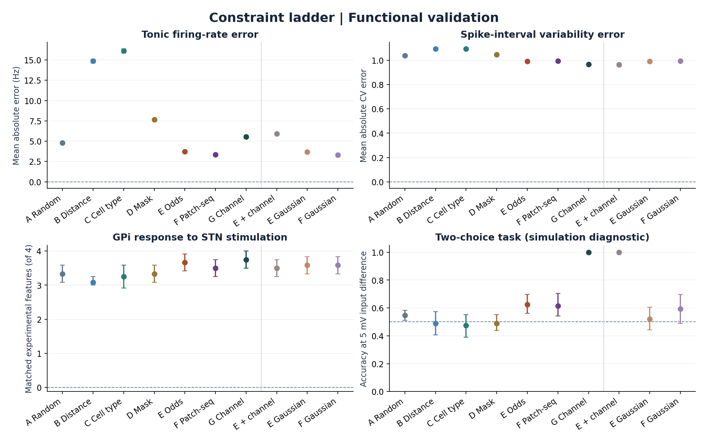
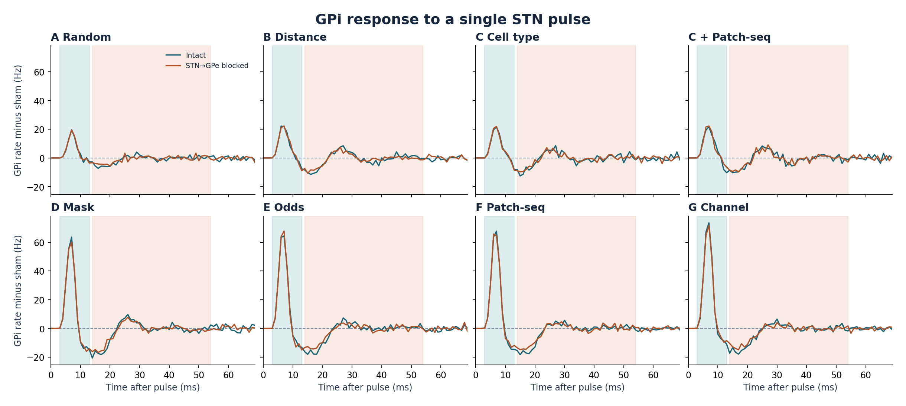

# 細胞の性質と配置から、回路機能をどこまで予測できたか

1,000ニューロンと19,680接続を固定し、新しい12シードで制約を段階的に追加した。探索的な追加条件を含む11条件、計132グラフを評価した。既知投射と経路別の重みを追加すると、距離・細胞型モデルで生じた定常発火率の大きな誤差が減った。Patch-seqで誤差が小さくなったのは、既知投射を含む構成だった。改善の大きさは、比較する生物学的制約と評価指標に依存した。

| 条件 | 定常発火率の誤差 ↓ | 発火間隔CVの誤差 ↓ | STN刺激の応答特徴 ↑ | 合成二択（5 mV差） |
|---|---:|---:|---:|---:|
| A ランダム | 4.79 Hz | 1.038 | 3.33 / 4 | 54.7% |
| B ＋距離 | 14.86 Hz | 1.094 | 3.08 / 4 | 49.0% |
| C ＋細胞型 | 16.13 Hz | 1.094 | 3.25 / 4 | 47.4% |
| C ＋実測膜時定数（探索的、既知投射なし） | 16.15 Hz | 1.095 | 3.25 / 4 | 49.0% |
| D ＋既知投射マスク | 7.64 Hz | 1.047 | 3.33 / 4 | 49.0% |
| E ＋経路別オッズ | 3.70 Hz | 0.993 | 3.67 / 4 | 62.5% |
| F ＋実測膜時定数 | **3.34 Hz** | 0.994 | 3.50 / 4 | 61.5% |
| G ＋同チャネル選好 | 5.56 Hz | 0.967 | 3.75 / 4 | **100%** |

発火率とCVは正常覚醒アカゲザル3個体の報告値に対するGPe・STN・GPiの平均絶対誤差。刺激は別の研究の実測に基づく4項目の一致数。二択は合成課題で、外部の行動データとの照合は行っていない。区間は12シード間の変動を表す。 [覚醒時の記録](https://pmc.ncbi.nlm.nih.gov/articles/PMC2677649/#T1) · [STN刺激の記録](https://pmc.ncbi.nlm.nih.gov/articles/PMC6725523/)

## どの制約が何を改善したか

- **距離・細胞型に実測膜時定数を加えても、定常発火の予測は改善しなかった。** 既知投射を使わない追加条件の定常誤差は16.15 Hz。Cからの変化は+0.01 Hz（対応95%区間 −0.02〜+0.04）。両条件ともSTNは約54 Hzで、外部参照の17.07 Hzより大幅に高かった。Dで27.34 Hz、Eで18.18 Hzになった。C→Dの定常誤差の変化は−8.50 Hz（−8.67〜−8.31）、D→Eは−3.94 Hz（−4.13〜−3.77）。Eの経路別オッズは文献に沿った仮定値で、投射密度の実測値は使っていない。
- **Patch-seqの膜特性は、定常発火率に小さな効果があった。** D1の中央値は8.79 ms（112細胞、39ドナー）、D2は9.04 ms（121細胞、43ドナー）。E→Fで定常誤差が−0.35 Hz（−0.37〜−0.33）。同チャネル選好を入れた場合は−0.34 Hz、ガウス座標の場合も−0.38 Hzだった。外部評価に背側線条体SPNの生体内記録は含まれていないため、この差は主に他領域への間接効果を表す。 [Patch-seq原著](https://doi.org/10.1016/j.cell.2026.10.028) · [集計の由来](patchseq_tau.json)
- **MRIマスクの細かな形状には、今回の外部指標で上積みが見えなかった。** 同じ領域重心と共分散を使ったガウス対照では、定常誤差がE相当で3.69 Hz、F相当で3.31 Hz。MRIマスクとの差（MRI−ガウス）はEで+0.01 Hz（−0.07〜+0.09）、Fで+0.04 Hz（−0.02〜+0.10）。この比較では大まかな領域配置は両方に残っている。
- **前回の二択の高さは、同チャネル選好の寄与が大きい。** F→Gで5 mV差の成績は61.5%から100%へ、2 mV差では50.5%から100%へ上がった。同時に外部の定常発火率誤差は2.22 Hz増えた（+2.03〜+2.40）。Patch-seqを入れなくても、同チャネル選好を入れたEの対照は5 mV差で100%だった。

## 刺激応答のうち残った誤差

> **追記（[細胞動態の追試](../dynamics/RESULTS.md)）。** 下記の「遮断後も残る抑制」は、STNとGPiの規則的な発火から生じる人工産物だった。既定の設定では、後期抑制のうち約87%が遮断後も残る、抑制性の経路を介さない成分だった。表の「STN刺激の応答特徴」のうち後期抑制の項目は、配線の妥当性の根拠として弱い。

EではSTN刺激に対してGPiが早期に+19.93 Hz、後期に−2.17 Hz反応した。STN→GPeを遮断しても後期応答は−1.90 Hzで、抑制の減弱は0.26 Hzにとどまった。最も特徴一致数が高いGでも、遮断後の後期応答は−2.32 Hzだった。原著ではGPe内で刺激応答を薬理的に遮断した後、対象のGPi細胞8個すべてで刺激依存の抑制が消えた。モデルでは遮断後も抑制が残り、介入の効果は部分的だった。モデルの介入はSTN→GPeの辺だけを無効にする近似で、薬理操作による局所回路全体の変化は含んでいない。 [Kitaら、図5・7](https://pmc.ncbi.nlm.nih.gov/articles/PMC6725523/)

D〜Gの遮断後に刺激が伝わる経路は、出力専用のGPiへの直接興奮だけになる。このためモデルの残存する後期の発火率低下は、早期の発火時刻の前倒しや不応期を含むGPi自身の発火動態で説明できる。波形の符号だけを照合すると、経路の働きが異なっても一致数が高くなりうる。

発火間隔のばらつきも過小だった。FのGPe・STN・GPiの平均CVは順に0.36、0.51、0.29で、外部の参照値は1.83、1.23、1.07。発火率の平均が近い条件でも、スパイク列の時間構造には大きな差が残る。

ここまでに得られたのは、**個別シナプスを観測せず、既知の領域間投射と実測の細胞特性を入れると、一部の集団指標を近づけられる**という結果。評価した回路は半球の一部を粗く表現し、既知の投射方向には過去のトレーシング情報を使っている。今回使った細胞の性質は粗い細胞型と単一の膜特性に限られ、配置はMRIマスク内の合成座標。さらに豊かな実測細胞特性と空間情報による予測や、別々の配線が同じ出力を与える可能性は未評価。

[実験手順とデータ出典](PROTOCOL.md) · [全対応差と区間](results/paired.csv) · [生データの照合記録](results/verification.txt)
